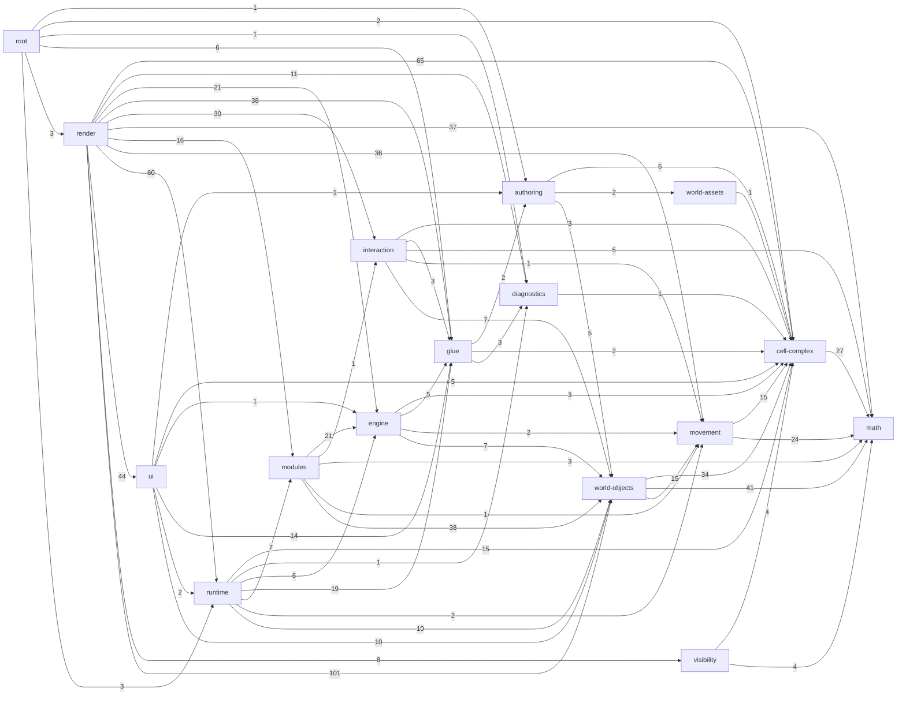

<!-- GENERATED by scripts/docs/generate-docs.mjs — do not edit by hand. Run `npm run docs:generate`. -->
<!-- Source of truth: the TypeScript modules under src/. This file is checked for freshness by `npm run docs:check` and the test suite. -->

# Architecture reference (generated)

This reference is produced from the source code. For the *meaning* of the modules — the mathematical model they implement — read [../MATHEMATICAL_MODEL.md](../MATHEMATICAL_MODEL.md) and [../ARCHITECTURE.md](../ARCHITECTURE.md). For every exported symbol see [API_REFERENCE.md](API_REFERENCE.md).

**319 modules, 63,036 lines** under `src/`.

## Layers

A module belongs to the layer named by its first path segment under `src/`. "May import" is the *intended* rule; violations are listed under [Layering debt](#layering-debt).

| Layer | Modules | Lines | May import | Purpose |
| --- | ---: | ---: | --- | --- |
| `math` | 8 | 746 | nothing | Vectors, rigid transforms, planes, polygons, tolerances. Pure; imports nothing. |
| `cell-complex` | 21 | 4,493 | `math` | Prism-cell specs, compilation, portal transforms, portal-path tables, static visibility culling, deformation families. |
| `diagnostics` | 2 | 474 | `math`, `cell-complex` | Debug levels and the runtime diagnostics recorder that every layer above may report to. |
| `visibility` | 2 | 1,036 | `math`, `cell-complex` | Per-frame portal visibility: funnel clipping of portal-path tables against a camera. Pure; no renderer. |
| `movement` | 13 | 2,929 | `math`, `cell-complex` | Player body, collision, movement and portal crossing in compiled cell complexes. |
| `world-assets` | 1 | 201 | `cell-complex` | Floor-texture and asset descriptors. |
| `world-objects` | 40 | 10,326 | `math`, `cell-complex`, `diagnostics`, `movement`, `world-assets` | Placeable runtime objects: registry, geodesic emitters, measurement tools, flags, creature behaviors. |
| `authoring` | 5 | 874 | `math`, `cell-complex`, `examples`, `world-assets`, `world-objects` | World builder DSL, world-script compiler, validation and world catalog. |
| `glue` | 12 | 1,060 | `math`, `cell-complex`, `diagnostics`, `authoring` | Launch options, debug settings, tool ids, asset URLs, app configuration. |
| `interaction` | 7 | 1,979 | `math`, `cell-complex`, `movement`, `world-objects`, `glue` | Renderer-free interaction logic: input frames, aim picking, VR locomotion, XR session state, carried-object portal transitions. |
| `engine` | 10 | 1,671 | `math`, `cell-complex`, `diagnostics`, `movement`, `world-objects`, `glue`, `interaction` | The world engine core (design 013): step order, command queue, participants, module composition and ticks. Imports no module. |
| `modules` | 29 | 2,757 | `math`, `cell-complex`, `diagnostics`, `movement`, `world-objects`, `glue`, `interaction`, `engine` | World modules (design 013): each owns a slice of world behaviour and exposes a typed api.ts to the others. |
| `runtime` | 16 | 2,980 | `math`, `cell-complex`, `diagnostics`, `movement`, `world-objects`, `authoring`, `glue`, `engine`, `modules` | Application state, runtime menu state, command dispatch, geometry session/worker, server channel and public API. |
| `ui` | 14 | 2,423 | `math`, `cell-complex`, `world-objects`, `authoring`, `glue`, `engine`, `modules`, `runtime` | Renderer-neutral palette, help, tooltip and input-intent definitions. |
| `render` | 138 | 28,873 | every lower layer | Three.js / DOM / WebXR rendering and input adapters (the application shell). |
| `root` | 1 | 214 | every lower layer | Entry point. |

## Layer dependency graph

Edges are *actual* imports aggregated by layer; the label is the number of importing module pairs.

Dashed edges violate the intended layering (see below).

## Layering debt

None: every import respects the intended layering.

## Module index

### `math`

| Module | Lines | Summary | Imports |
| --- | ---: | --- | --- |
| `math/intersections.ts` | 73 | Segment-versus-plane intersection. | `math/planes`, `math/tolerances`, `math/vec3` |
| `math/latticeReduction.ts` | 52 | Lagrange-Gauss reduction of a plane lattice basis and the lattice's covering radius. | — |
| `math/planes.ts` | 65 | Oriented planes in 3D and point-versus-plane classification. | `math/tolerances`, `math/vec3` |
| `math/polygons.ts` | 136 | Planar polygons in the horizontal x/y plane: signed area, validation and point-in-polygon classification. | `math/tolerances` |
| `math/rigidTransform3.ts` | 176 | Rigid (orientation-preserving, distance-preserving) transforms of 3D space and 3x3 rotation matrices. | `math/vec3` |
| `math/tolerances.ts` | 79 | Shared absolute tolerance for geometric comparisons. | — |
| `math/vec2.ts` | 54 | Two-dimensional vector helpers on `Vec2xy` ({ x, y }, meters): sum, difference, scaling, dot and cross products, length. | `math/polygons` |
| `math/vec3.ts` | 111 | Immutable 3D vector type and the small set of free functions used throughout the engine. | `math/tolerances` |

### `cell-complex`

| Module | Lines | Summary | Imports |
| --- | ---: | --- | --- |
| `cell-complex/compileCellComplex.ts` | 65 | Top-level compiler from an authored cell-complex spec to the runtime geometry used by movement and rendering. | `cell-complex/compilePortalTransforms`, `cell-complex/prismCells`, `cell-complex/specs`, `cell-complex/validateCellComplexSpec` |
| `cell-complex/compilePortalTransforms.ts` | 91 | Derives the rigid gluing map of every portal from the geometry of the two sides it joins. | `cell-complex/prismCells`, `cell-complex/specs`, `math/rigidTransform3`, `math/vec3` |
| `cell-complex/deformations/torusModuli.ts` | 95 | The modulus of a flat torus, for the geometry computer's readout. | `math/latticeReduction` |
| `cell-complex/deformations/torusSkewDeformation.ts` | 431 | Deformation family for the one-cell torus world: the cell "torus-room" is a prism whose footprint is a parallelogram with edge vectors u = (w, 0) and v = (a, b), and opposite sides glued by translation (side-0 with side… | `cell-complex/compileCellComplex`, `cell-complex/floorUv`, `cell-complex/specs`, `cell-complex/worldGeometryDeformations`, `math/vec3` |
| `cell-complex/describeGeometry.ts` | 48 | Human-readable text summary of an authored cell-complex spec, for logging and debugging. | `cell-complex/specs` |
| `cell-complex/developedDisk.ts` | 298 | Developed-disk atlas: lists every cell copy that a disk of radius rho around a point overlaps. | `cell-complex/compileCellComplex`, `cell-complex/prismCells`, `math/polygons`, `math/rigidTransform3`, `math/tolerances`, `math/vec3` |
| `cell-complex/floorUv.ts` | 152 | Floor texture coordinates. | `math/latticeReduction` |
| `cell-complex/forbiddenZones.ts` | 47 | Constants and types for forbidden zones: vertical cylinders at cell base vertices where portal sides meet. | — |
| `cell-complex/orientedPortal.ts` | 50 | Oriented portal segments: a portal side developed into a root cell's plan, with its left and right endpoints as seen when leaving the source cell through it. | `cell-complex/compileCellComplex`, `math/polygons`, `math/rigidTransform3`, `math/vec3` |
| `cell-complex/platonicSolid.ts` | 142 | Recognizes a world that is the surface of a Platonic solid, and places its cells on that solid. | `cell-complex/compileCellComplex`, `cell-complex/prismCells`, `cell-complex/specs`, `math/rigidTransform3`, `math/vec3` |
| `cell-complex/portalPathDebug.ts` | 235 | Debugging helpers that explain what happened to a portal path during table construction and static culling. | `cell-complex/compileCellComplex`, `cell-complex/portalPaths`, `cell-complex/staticPortalPathCull` |
| `cell-complex/portalPaths.ts` | 260 | Portal-path tables: for each root cell, every portal word (sequence of portals crossed) up to a depth limit, with the rigid transforms that place the destination cell in the root cell's frame. | `cell-complex/compileCellComplex`, `cell-complex/orientedPortal`, `cell-complex/specs`, `math/rigidTransform3` |
| `cell-complex/portalRoute.ts` | 163 | Routes through portals that best explain a movement: which chain of portals an object crossed to get from one place to another. | `cell-complex/compileCellComplex`, `cell-complex/segmentWalk`, `math/rigidTransform3`, `math/vec3` |
| `cell-complex/prismBase.ts` | 107 | Type-level and runtime validation of the base polygon of a prism cell. | `math/tolerances` |
| `cell-complex/prismCells.ts` | 185 | Compiled runtime representation of a single prism cell and its sides. | `cell-complex/forbiddenZones`, `cell-complex/specs` |
| `cell-complex/segmentWalk.ts` | 286 | Shared segment-walk kernel: walks a straight segment, given in the frame of its start cell, through the glued convex cells. | `cell-complex/compileCellComplex`, `cell-complex/prismCells`, `cell-complex/specs`, `math/polygons`, `math/rigidTransform3`, `math/tolerances`, `math/vec3` |
| `cell-complex/specs.ts` | 301 | Authoring-level data model for a cell complex: the plain-data spec that world files produce and the compiler consumes. | `math/rigidTransform3` |
| `cell-complex/staticLineCone.ts` | 259 | Convex cones of oriented plan-view lines that cross a sequence of developed portals in order, in the forward sense. | `cell-complex/orientedPortal`, `math/vec3` |
| `cell-complex/staticPortalPathCull.ts` | 576 | Static, view-independent culling of portal-path tables: discards portal words through which no sight line from the root cell could cross the portals in order. | `cell-complex/compileCellComplex`, `cell-complex/orientedPortal`, `cell-complex/portalPaths`, `cell-complex/specs`, `cell-complex/staticLineCone`, `math/rigidTransform3` |
| `cell-complex/validateCellComplexSpec.ts` | 249 | Cell-complex spec validator: structural checks on a CellComplexSpec before it is compiled (authoring spec -> compiled complex stage). | `cell-complex/specs` |
| `cell-complex/worldGeometryDeformations.ts` | 453 | Family-independent vocabulary and helpers for live deformation of a cell complex while preserving its combinatorics (cells, sides, portals and their pairing). | `cell-complex/compileCellComplex`, `cell-complex/floorUv`, `cell-complex/specs`, `math/rigidTransform3`, `math/vec3` |

### `diagnostics`

| Module | Lines | Summary | Imports |
| --- | ---: | --- | --- |
| `diagnostics/debugLevels.ts` | 49 | Defines the debug levels (off, basic, verbose) as a single constant table that is the source of truth for the DebugLevelId type, the settings UI and URL parsing. | — |
| `diagnostics/runtimeDiagnostics.ts` | 425 | Optional runtime diagnostics: asset load tracking, portal transition log, slow-frame warnings and a browser long-task watcher. | `cell-complex/compileCellComplex`, `diagnostics/debugLevels` |

### `visibility`

| Module | Lines | Summary | Imports |
| --- | ---: | --- | --- |
| `visibility/portalFunnel.ts` | 471 | The exact per-frame visibility funnel: plan-direction sectors from the eye, clipped portal by portal, and the four half-spaces through the eye that bound a path's visible region. | `cell-complex/orientedPortal`, `math/polygons`, `math/vec3` |
| `visibility/visiblePortalPaths.ts` | 565 | Per-frame portal visibility: decides which entries of a root cell's portal-path table are visible on screen and returns, for each, its placement, the four planes through the eye that bound its visible region, and the co… | `cell-complex/compileCellComplex`, `cell-complex/orientedPortal`, `cell-complex/portalPaths`, `math/rigidTransform3`, `math/vec3`, `visibility/portalFunnel` |

### `movement`

| Module | Lines | Summary | Imports |
| --- | ---: | --- | --- |
| `movement/collision.ts` | 350 | Collision tests of a dynamic object against its current cell, and helpers for side-relative geometry. | `cell-complex/forbiddenZones`, `cell-complex/prismCells`, `math/rigidTransform3`, `math/vec3`, `movement/dynamicObject` |
| `movement/depenetrateDynamicObject.ts` | 178 | Pushes a body that overlaps forbidden-zone cylinders or walls of its cell back to a legal pose. | `cell-complex/compileCellComplex`, `cell-complex/prismCells`, `math/rigidTransform3`, `math/tolerances`, `math/vec3`, `movement/collision`, `movement/dynamicObject`, `movement/portalCrossing` |
| `movement/developedObstacles.ts` | 206 | Collects the obstacles around a body in one flat frame by developing the neighbouring cells with the developed-disk atlas. | `cell-complex/compileCellComplex`, `cell-complex/developedDisk`, `math/polygons`, `math/rigidTransform3`, `math/tolerances`, `math/vec3`, `movement/collision`, `movement/dynamicObject`, `movement/sweptCollision` |
| `movement/dynamicObject.ts` | 49 | State of a movable object (player body, creature, geodesic emitter) inside a compiled cell complex. | `math/rigidTransform3`, `math/vec3` |
| `movement/dynamicObjectMotion.ts` | 60 | Motion scripts for objects other than the player (NPCs): the trial move of a {@link MotionEnvironment} built on `moveDynamicObject`, so a creature's behavior can run the same scripts as the player (`createMotionRunner`). | `cell-complex/compileCellComplex`, `movement/developedObstacles`, `movement/dynamicObject`, `movement/motionRunner`, `movement/moveDynamicObject`, `movement/playerPose` |
| `movement/motionRunner.ts` | 787 | Runs a {@link MotionScript} for one walker (the player or an NPC), with no renderer and no clock of its own. | `cell-complex/compileCellComplex`, `cell-complex/portalRoute`, `cell-complex/segmentWalk`, `math/rigidTransform3`, `math/vec3`, `movement/motionScript`, `movement/playerPose` |
| `movement/motionScript.ts` | 428 | Motion scripts: a plain-data description of how a walker (the player or an NPC) moves and looks, and its normalization. | `math/vec3` |
| `movement/moveDynamicObject.ts` | 336 | Advances a dynamic object by a displacement inside the glued cell complex with swept collision, wall sliding and any number of portal crossings. | `cell-complex/compileCellComplex`, `cell-complex/segmentWalk`, `math/rigidTransform3`, `math/tolerances`, `math/vec3`, `movement/collision`, `movement/developedObstacles`, `movement/dynamicObject`, `movement/sweptCollision` |
| `movement/movePlayer.ts` | 167 | Player locomotion: applies look and move input to a player pose, with collision and portal crossing when a world is given. | `cell-complex/compileCellComplex`, `cell-complex/segmentWalk`, `math/rigidTransform3`, `math/vec3`, `movement/collision`, `movement/developedObstacles`, `movement/dynamicObject`, `movement/moveDynamicObject`, `movement/playerBody`, `movement/playerPose` |
| `movement/playerBody.ts` | 35 | Physical dimensions of the player's body used for collision and eye placement. | — |
| `movement/playerPose.ts` | 62 | Player pose (cell, position, yaw, pitch) and its conversion to and from the generic dynamic-object representation. | `math/rigidTransform3`, `math/vec3`, `movement/dynamicObject` |
| `movement/portalCrossing.ts` | 32 | Re-expressing an object's or player's pose in the target cell's frame when it passes through a portal. | `cell-complex/specs`, `math/rigidTransform3`, `movement/dynamicObject`, `movement/playerPose` |
| `movement/sweptCollision.ts` | 239 | Swept collision of a moving disc against discs and capsules in one flat plane, and the slide loop built on it. | `math/polygons`, `math/tolerances` |

### `world-assets`

| Module | Lines | Summary | Imports |
| --- | ---: | --- | --- |
| `world-assets/floorTextures.ts` | 201 | Floor texture library: the named floor appearances world scripts can use, via the `floorTexture` helper. | `cell-complex/specs` |

### `world-objects`

| Module | Lines | Summary | Imports |
| --- | ---: | --- | --- |
| `world-objects/carry.ts` | 397 | The carry contract: what it means for an object to be carried, stated once, as pure functions of the world and the object. | `cell-complex/compileCellComplex`, `cell-complex/portalRoute`, `cell-complex/segmentWalk`, `math/rigidTransform3`, `math/tolerances`, `math/vec3`, `movement/developedObstacles`, `movement/sweptCollision`, `world-objects/carryHighlightShape`, `world-objects/geodesic/objects` |
| `world-objects/carryHighlightShape.ts` | 45 | The shape of the highlight drawn around a carried object. | `math/vec3` |
| `world-objects/creatures/geodesicMarmotBehavior.ts` | 149 | Motion of the geodesic marmot, with no renderer: the state it owns, how it advances each frame along its heading (a locally straight geodesic that stays straight as portals re-express the frame), and how it follows geom… | `cell-complex/compileCellComplex`, `cell-complex/prismCells`, `cell-complex/specs`, `cell-complex/worldGeometryDeformations`, `math/rigidTransform3`, `math/vec3`, `movement/depenetrateDynamicObject`, `movement/dynamicObject`, `movement/moveDynamicObject`, `world-objects/geodesicMarmot`, `world-objects/runtimeObjectBase`, `world-objects/runtimeObjectRegistry`, `world-objects/worldObjectOwner` |
| `world-objects/creatures/simpleGeoCreatureBehavior.ts` | 706 | Motion of the simple geodesic creatures (the mouse and the butterfly), with no renderer: the state a creature owns, how it advances each frame, and how it follows geometry changes. | `cell-complex/compileCellComplex`, `cell-complex/prismCells`, `cell-complex/segmentWalk`, `cell-complex/specs`, `cell-complex/worldGeometryDeformations`, `math/rigidTransform3`, `math/vec3`, `movement/collision`, `movement/depenetrateDynamicObject`, `movement/dynamicObject`, `movement/moveDynamicObject`, `world-objects/runtimeObjectBase`, `world-objects/runtimeObjectRegistry`, `world-objects/simpleGeoCreature`, `world-objects/worldObjectOwner` |
| `world-objects/derived.ts` | 220 | The derived cache (design 014 section 4): a value defined by a full `compute` over a source, invalidated by relevant entries on the change ring and recomputed on the next read. | `world-objects/runtimeObjectChangeJournal` |
| `world-objects/geodesic/anchors.ts` | 20 | Anchors of geodesic intervals: which registry objects can hold an endpoint, and where the beam of one starts in its cell frame. | `math/vec3`, `world-objects/geodesic/objects`, `world-objects/runtimeObjectRegistry` |
| `world-objects/geodesic/arcIndex.ts` | 85 | The arc index (design 014 section 7.1): which arc ends sit on each anchor, built by one pass over the arcs and cached. | `world-objects/derived`, `world-objects/geodesic/objects`, `world-objects/runtimeObjectRegistry` |
| `world-objects/geodesic/beamRows.ts` | 43 | The rows of the Laser menu's beam list (design 017 section 8.5): one readable line per beam, from the registry. | `world-objects/geodesic/lifecycle`, `world-objects/geodesic/segments`, `world-objects/runtimeObjectRegistry`, `world-objects/vocabulary` |
| `world-objects/geodesic/cannon.ts` | 899 | Emitter (cannon) operations: shooting, extending and re-aiming geodesics, connecting a geodesic to an emitter, rebuilding connected geodesics between emitters, and placing cannons on the floor, on a geodesic or at a geo… | `cell-complex/compileCellComplex`, `math/rigidTransform3`, `math/vec3`, `movement/collision`, `world-objects/geodesic/endpoints`, `world-objects/geodesic/intervals`, `world-objects/geodesic/lifecycle`, `world-objects/geodesic/objects`, `world-objects/geodesic/segments`, `world-objects/geodesic/trace`, `world-objects/runtimeObjectBase`, `world-objects/runtimeObjectRegistry`, `world-objects/vocabulary` |
| `world-objects/geodesic/cannonToolState.ts` | 13 | The editing state of the geodesic emitter (cannon) tools, as plain data: which cannon and geodesic the tool works on. | — |
| `world-objects/geodesic/carryEnd.ts` | 86 | What an emitter does to its geodesics when it has been carried: the rebuild after a move and the final rebuild when the carry ends. | `cell-complex/compileCellComplex`, `world-objects/geodesic/cannon`, `world-objects/geodesic/endpoints`, `world-objects/geodesic/lifecycle`, `world-objects/geodesic/segments`, `world-objects/runtimeObjectRegistry` |
| `world-objects/geodesic/cutAtEmitter.ts` | 167 | Cutting the arcs that pass through an emitter: an emitter set down on a geodesic's path becomes a point of it. | `cell-complex/compileCellComplex`, `world-objects/geodesic/intervals`, `world-objects/geodesic/objects`, `world-objects/geodesic/portalWord`, `world-objects/geodesic/segments`, `world-objects/runtimeObjectRegistry` |
| `world-objects/geodesic/development.ts` | 21 | Development of portal words: inverse portal transforms, cached per compiled portal (a compiled world is immutable, so a WeakMap keyed by portal is always valid); pure. | `cell-complex/specs`, `math/rigidTransform3` |
| `world-objects/geodesic/endpoints.ts` | 372 | Endpoint attachments of geodesic intervals: lookup by anchor, re-attachment, lifting the far endpoint into the source cell, word-against-cell-chain checks, and emitter cache cleanup. | `cell-complex/compileCellComplex`, `math/rigidTransform3`, `world-objects/geodesic/anchors`, `world-objects/geodesic/arcIndex`, `world-objects/geodesic/development`, `world-objects/geodesic/objects`, `world-objects/geodesic/portalWord`, `world-objects/runtimeObjectRegistry` |
| `world-objects/geodesic/intersections.ts` | 369 | Geodesic intersection markers: crossings of segments in the same cell, stable marker identities between updates, and the per-registry marker memory. | `math/rigidTransform3`, `math/vec2`, `math/vec3`, `world-objects/geodesic/objects`, `world-objects/runtimeObjectRegistry` |
| `world-objects/geodesic/intervals.ts` | 877 | Interval rebuilds: realizing an interval's lifted chord, aiming free geodesics, splitting at a segment hit, rebuilding connected intervals after a carried anchor moved, and side-effect-free previews. | `cell-complex/compileCellComplex`, `math/rigidTransform3`, `math/vec3`, `world-objects/geodesic/anchors`, `world-objects/geodesic/endpoints`, `world-objects/geodesic/objects`, `world-objects/geodesic/portalWord`, `world-objects/geodesic/segments`, `world-objects/geodesic/trace`, `world-objects/runtimeObjectRegistry` |
| `world-objects/geodesic/lifecycle.ts` | 118 | Queries whether an arc connects emitters or follows one, and removal of geodesics and cannons together with their derived objects. | `world-objects/geodesic/endpoints`, `world-objects/geodesic/objects`, `world-objects/geodesic/segments`, `world-objects/runtimeObjectRegistry` |
| `world-objects/geodesic/objects.ts` | 560 | Geodesic emitters (formerly "cannons"), geodesic arcs and curve shortening on a glued cell complex. | `math/rigidTransform3`, `math/vec3`, `movement/dynamicObject`, `world-objects/carryHighlightShape`, `world-objects/runtimeObjectBase`, `world-objects/vocabulary` |
| `world-objects/geodesic/portalWord.ts` | 159 | Portal-word algebra of geodesic intervals: reversal, free reduction, comparison, role-aware sub-words and the update of a word when an anchor crosses a portal; pure, no registry access. | `cell-complex/compileCellComplex`, `world-objects/geodesic/objects` |
| `world-objects/geodesic/segments.ts` | 404 | Derived geodesic segments: lookup by geodesic, building segments from traces with the start/end half split, lengths, tangents at anchors and display numbers. | `math/rigidTransform3`, `math/vec3`, `world-objects/geodesic/endpoints`, `world-objects/geodesic/objects`, `world-objects/runtimeObjectRegistry`, `world-objects/vocabulary` |
| `world-objects/geodesic/trace.ts` | 486 | Tracing a horizontal geodesic ray through a compiled cell complex: the single-cell tracer, the multi-cell walk on the segment-walk kernel, and forbidden-zone (open-disk) and emitter hits. | `cell-complex/compileCellComplex`, `cell-complex/segmentWalk`, `math/rigidTransform3`, `math/vec2`, `math/vec3`, `world-objects/geodesic/objects`, `world-objects/runtimeObjectRegistry` |
| `world-objects/geodesic/vertices.ts` | 530 | Operations on the vertices of a piecewise-geodesic curve (design 013 section 13.1): the arcs at a vertex, their tangents and length, moving a vertex (each incident arc keeps its homotopy class: its word changes exactly … | `cell-complex/compileCellComplex`, `cell-complex/segmentWalk`, `math/rigidTransform3`, `math/vec3`, `world-objects/geodesic/anchors`, `world-objects/geodesic/arcIndex`, `world-objects/geodesic/endpoints`, `world-objects/geodesic/intervals`, `world-objects/geodesic/lifecycle`, `world-objects/geodesic/objects`, `world-objects/geodesic/portalWord`, `world-objects/geodesic/segments`, `world-objects/runtimeObjectRegistry` |
| `world-objects/geodesicMarmot.ts` | 96 | Geodesic marmot: an autonomous creature that walks in a straight line (a locally straight geodesic) through the cell complex, crossing portals. | `cell-complex/specs`, `math/rigidTransform3`, `math/vec3`, `world-objects/runtimeObjectBase` |
| `world-objects/helpHubCopy.ts` | 11 | Help-hub copy shared by the authoring layer (world tutorial text) and the ui layer (palette and help hubs), so both show identical wording. | `world-objects/vocabulary` |
| `world-objects/interactionRange.ts` | 12 | How far a person may be from a runtime object to interact with it: the one number the aim system (to focus and pick up) and the carry module (to refuse a pickup out of reach) both read. | `world-objects/runtimeObjectRegistry` |
| `world-objects/library.ts` | 482 | World object library: the catalogue of named, ready-to-place objects available to world scripts (tree, house, bench, geo_mouse, geodesic_marmot, ...). | `cell-complex/specs`, `world-objects/geodesicMarmot`, `world-objects/objectMetadata`, `world-objects/simpleGeoCreature`, `world-objects/staticAssets`, `world-objects/vocabulary` |
| `world-objects/measureLengthTool.ts` | 239 | Measured-length tool: persistent "geodesic length = N m" labels attached to a geodesic. | `cell-complex/compileCellComplex`, `cell-complex/portalRoute`, `math/rigidTransform3`, `math/vec3`, `world-objects/geodesic/objects`, `world-objects/geodesic/segments`, `world-objects/runtimeObjectRegistry`, `world-objects/toolObjects`, `world-objects/vocabulary` |
| `world-objects/objectMetadata.ts` | 12 | Collision class name ("user") of the player's avatar; objects listing it in `do_not_collide_with` do not block the player. | — |
| `world-objects/placedFlags.ts` | 209 | Placed flags (signs): player-placed wooden signs carrying a short text label. | `cell-complex/compileCellComplex`, `math/rigidTransform3`, `math/vec3`, `movement/collision`, `movement/dynamicObject`, `world-objects/runtimeObjectBase`, `world-objects/runtimeObjectRegistry`, `world-objects/toolObjects`, `world-objects/vocabulary` |
| `world-objects/protractorTool.ts` | 587 | Protractor tool: persistent angle measurements between two geodesic directions at a common vertex. | `math/rigidTransform3`, `math/vec3`, `world-objects/geodesic/endpoints`, `world-objects/geodesic/intersections`, `world-objects/geodesic/objects`, `world-objects/geodesic/segments`, `world-objects/measureLengthTool`, `world-objects/runtimeObjectRegistry`, `world-objects/toolObjects` |
| `world-objects/runtimeObjectBase.ts` | 96 | The fields every object in the runtime object registry shares, and the projection of such an object onto the movement/collision state. | `cell-complex/specs`, `math/rigidTransform3`, `movement/dynamicObject` |
| `world-objects/runtimeObjectChangeJournal.ts` | 181 | Change journal of the runtime object registry (design 013 section 6.2) over a change ring with absolute sequence numbers (design 014 section 3.1). | — |
| `world-objects/runtimeObjectRegistry.ts` | 489 | Runtime object registry: the per-cell, id-indexed store of every live (non-terrain) object in the world. | `cell-complex/specs`, `math/rigidTransform3`, `world-objects/geodesic/objects`, `world-objects/objectMetadata`, `world-objects/runtimeObjectBase`, `world-objects/runtimeObjectChangeJournal`, `world-objects/toolObjects`, `world-objects/vocabulary` |
| `world-objects/savedSnapshot.ts` | 55 | Snapshot and restore of the student's work, for undo (design 017 section 8.8). | `world-objects/runtimeObjectChangeJournal`, `world-objects/runtimeObjectRegistry` |
| `world-objects/simpleGeoCreature.ts` | 194 | Simple geodesic creatures: the mouse and the butterfly, autonomous walkers that follow straight lines (geodesics) through the cell complex. | `cell-complex/specs`, `math/rigidTransform3`, `math/vec3`, `world-objects/runtimeObjectBase`, `world-objects/staticAssets` |
| `world-objects/staticAssets.ts` | 102 | Static asset authoring helper: converts author-facing parameters for a glTF decoration into an AssetObjectSpec. | `cell-complex/specs` |
| `world-objects/toolObjects.ts` | 102 | Registry record types of the results of the player's tools: placed flags (signs), geodesic length labels and protractor angles. | `math/vec3`, `world-objects/geodesic/objects`, `world-objects/runtimeObjectBase` |
| `world-objects/trackedReads.ts` | 153 | Read tracking for pure refresh functions (design 014 D1, D9): the exact set of registry reads a refresh made, and the test of whether a range of the change ring touches it. | `world-objects/derived`, `world-objects/runtimeObjectChangeJournal`, `world-objects/runtimeObjectRegistry` |
| `world-objects/vocabulary.ts` | 443 | The student vocabulary (design 017 section 6): every student-visible noun, verb and subtitle of the app, in one place. | — |
| `world-objects/worldObjectOwner.ts` | 137 | World object owners: the single authority on the pose of an object that can be moved (creatures, the marmot, collidable static assets). | `cell-complex/compileCellComplex`, `cell-complex/worldGeometryDeformations`, `math/rigidTransform3`, `movement/depenetrateDynamicObject`, `world-objects/runtimeObjectBase`, `world-objects/runtimeObjectRegistry` |

### `authoring`

| Module | Lines | Summary | Imports |
| --- | ---: | --- | --- |
| `authoring/compileWorldScript.ts` | 107 | World-script compiler: runs a world script's JavaScript text against a sandboxed name scope and returns the resulting CellComplexSpec (authoring script -> CellComplexSpec stage of the pipeline). | `authoring/worldBuilder`, `cell-complex/specs`, `world-assets/floorTextures`, `world-objects/library` |
| `authoring/exampleWorlds.ts` | 62 | Bundled example worlds: compiles the .world.js scripts in src/examples/ (imported as raw text) into CellComplexSpec constants at module load. | `authoring/compileWorldScript`, `cell-complex/specs` |
| `authoring/validateAuthoringSpec.ts` | 11 | Compatibility re-export of the spec validator, which now lives in cell-complex/validateCellComplexSpec so the compiler does not import the authoring layer. | `cell-complex/validateCellComplexSpec` |
| `authoring/worldBuilder.ts` | 588 | World builder: the imperative API behind the world-script DSL that assembles a CellComplexSpec. | `cell-complex/prismBase`, `cell-complex/specs`, `world-assets/floorTextures`, `world-objects/helpHubCopy`, `world-objects/library`, `world-objects/staticAssets`, `world-objects/vocabulary` |
| `authoring/worldCatalog.ts` | 106 | World catalog: the list of selectable bundled worlds and the lookup that turns a world id (or a file-like name) into a CellComplexSpec. | `authoring/exampleWorlds`, `cell-complex/specs` |

### `glue`

| Module | Lines | Summary | Imports |
| --- | ---: | --- | --- |
| `glue/appConfig.ts` | 307 | Loads and normalizes the app configuration: a per-deployment JavaScript file (<name>.config.js in the public folder, chosen by the ?config= URL parameter) that sets the starting world, which menu sections and tools are … | `authoring/worldCatalog`, `cell-complex/compileCellComplex`, `cell-complex/platonicSolid`, `diagnostics/debugLevels`, `glue/assetUrls`, `glue/debugOptions`, `glue/portalPanelMode`, `glue/toolIds` |
| `glue/assetUrls.ts` | 26 | Builds URLs for files served from the Vite public folder. | — |
| `glue/debugOptions.ts` | 113 | Defines the individual debug options (diagnostics logging, portal path/cull inspection, overlays, wireframes, hitbox displays) as a constant table that is the source of truth for the DebugOptionId type. | — |
| `glue/debugSettings.ts` | 46 | Value types describing a complete debug configuration (level, portal panel mode and enabled options) and a predicate telling whether a change to it can be applied to a running world without a reload. | `diagnostics/debugLevels`, `glue/debugOptions`, `glue/portalPanelMode` |
| `glue/launchOptionsUrl.ts` | 93 | Converts between launch options and URL query parameters: strips them from the visible address after startup (so reloads and shared links are clean) and builds a shareable URL that reproduces the current options. | `glue/appConfig`, `glue/debugOptions`, `glue/readLaunchOptions`, `glue/toolIds`, `glue/uiOptions` |
| `glue/loadingStatus.ts` | 89 | Minimal DOM loading screen shown while a world loads: a log of phase lines with the latest highlighted, plus an error state. | — |
| `glue/portalPanelMode.ts` | 57 | Defines the portal panel display modes (none, panel, panel-with-text, text-only) as a constant table and the predicates deciding which portal visuals a mode draws. | — |
| `glue/readLaunchOptions.ts` | 153 | Parses the page URL's query string into a LaunchOptions record, with precedence: explicit URL parameter, then the app config's value, then the built-in default. | `authoring/worldCatalog`, `diagnostics/debugLevels`, `glue/appConfig`, `glue/debugOptions`, `glue/portalPanelMode`, `glue/toolIds`, `glue/uiOptions`, `glue/vrComfortOptions` |
| `glue/toolIds.ts` | 59 | Identifiers of the player's tools and of the debug-overlay items, with the canonical parse and serialize of the overlay-item list. | — |
| `glue/uiOptions.ts` | 51 | Defines the optional UI widgets that launch options can show (WorldSelector, DebugButton) as a constant table that is the source of truth for the UiOptionId type, with canonical parse and serialize helpers for the comma… | — |
| `glue/vrComfortOptions.ts` | 44 | Pure (Three-free) VR comfort settings: the `VrComfortOptions` record and its defaults. | — |
| `glue/xrLayout.ts` | 22 | The VR controller layout and the two hand options that choose it (design 017 sections 7.2 and 7.3). | — |

### `interaction`

| Module | Lines | Summary | Imports |
| --- | ---: | --- | --- |
| `interaction/aimTarget.ts` | 1367 | Aim picking: finds what an aim ray (desktop crosshair or XR controller) hits, across portals. | `cell-complex/compileCellComplex`, `cell-complex/prismCells`, `cell-complex/segmentWalk`, `math/rigidTransform3`, `math/vec3`, `movement/collision`, `world-objects/geodesic/endpoints`, `world-objects/geodesic/objects`, `world-objects/geodesic/segments`, `world-objects/protractorTool`, `world-objects/runtimeObjectBase`, `world-objects/runtimeObjectRegistry` |
| `interaction/handCarry.ts` | 58 | The player's hand as a carrier: when does it let go of what it carries? | `world-objects/carry` |
| `interaction/inputFrame.ts` | 48 | The per-frame input sample handed to the simulation by either the desktop or the XR controller (`DesktopInputFrame` in desktopControls derives from it). | `glue/xrLayout`, `math/vec3` |
| `interaction/vrLocomotion.ts` | 114 | Pure functions turning XR thumbstick and head-tracking input into player-local motion requests. | `glue/vrComfortOptions`, `math/vec3` |
| `interaction/xrBeltMath.ts` | 145 | Placement maths of the VR tool belt (design 017 sections 7.3 and 7.4), renderer-free and in the Three.js frame (meters, y up, -z forward): the strap's slot layout, the waist anchor of the one-controller belt, the enlarg… | `math/vec3` |
| `interaction/xrHandRoles.ts` | 98 | Hand roles for VR input (design 017 sections 7.2 and 7.3), renderer-free: from the input sources that have a gamepad (and the two hand options) it picks the layout and says which source is the pointer hand and which is … | `glue/xrLayout` |
| `interaction/xrSessionState.ts` | 149 | Pure model of the immersive-VR session lifecycle shown in the UI and debug state, plus support detection. | — |

### `engine`

| Module | Lines | Summary | Imports |
| --- | ---: | --- | --- |
| `engine/composeModules.ts` | 317 | Composition of an experience's modules, once at engine creation (design 013 section 9.2). | `cell-complex/compileCellComplex`, `engine/moduleTypes`, `glue/toolIds`, `world-objects/runtimeObjectRegistry` |
| `engine/coreIds.ts` | 51 | The names the engine knows without any module: the object kinds of the registry's core union and the tool ids of the core tools. | `glue/toolIds`, `world-objects/runtimeObjectRegistry` |
| `engine/ids.ts` | 23 | Engine-allocated object ids: "<family>:<serial>" with one counter per family, never reused (design 013 section 5.1; no `Date.now()`). | `engine/moduleTypes` |
| `engine/moduleTicks.ts` | 128 | The bodies, simulate and derive passes over the composed modules (design 013 sections 5.2 and 6.4). | `engine/composeModules`, `engine/moduleTypes`, `engine/writeGuard`, `world-objects/runtimeObjectChangeJournal` |
| `engine/moduleTypes.ts` | 404 | The types of the world engine and of its modules (design 013 sections 5 and 9): commands and their results, participants, the read view, tokens, module definitions and the contexts the engine hands to handlers and ticks. | `cell-complex/compileCellComplex`, `glue/toolIds`, `movement/playerPose`, `world-objects/runtimeObjectRegistry`, `world-objects/toolObjects` |
| `engine/participants.ts` | 88 | Participants and control slots of the world engine (design 013 sections 5.1 and 5.4). | `engine/moduleTypes` |
| `engine/simulationClock.ts` | 188 | The simulation clock (design 012 P8, 013 section 6.5): turns elapsed real time into ticks of length \(h\). | — |
| `engine/toolGates.ts` | 40 | Tool gates and the confirmation protocol's world side (design 013 section 8). | `glue/toolIds` |
| `engine/worldEngine.ts` | 338 | The world engine (design 013 section 5): the owner of world state, which changes only inside `step`, from queued commands, and inside `applyControls`, from control slots. | `cell-complex/compileCellComplex`, `engine/composeModules`, `engine/coreIds`, `engine/ids`, `engine/moduleTicks`, `engine/moduleTypes`, `engine/participants`, `engine/simulationClock`, `engine/toolGates`, `engine/writeGuard`, `glue/toolIds`, `movement/playerPose`, `world-objects/runtimeObjectRegistry` |
| `engine/writeGuard.ts` | 94 | Who is acting: a stack of module frames, and the write guard built on it (design 013 section 9.6). | `world-objects/runtimeObjectRegistry` |

### `modules`

| Module | Lines | Summary | Imports |
| --- | ---: | --- | --- |
| `modules/carry/api.ts` | 68 | The carry module's public face (design 013 sections 7 and 12.1): the names of its commands, events and control slot, and their plain-data shapes. | `engine/moduleTypes` |
| `modules/carry/index.ts` | 5 | The carry module's world factory (design 013 section 12.1). | `modules/carry/module` |
| `modules/carry/module.ts` | 242 | The carry module (design 013 section 7): who carries what is world state. | `engine/moduleTypes`, `interaction/handCarry`, `math/rigidTransform3`, `modules/carry/api`, `modules/geodesicEmitters/api`, `movement/collision`, `world-objects/carry`, `world-objects/geodesic/objects`, `world-objects/interactionRange`, `world-objects/runtimeObjectBase`, `world-objects/runtimeObjectRegistry` |
| `modules/curveShortening/api.ts` | 53 | The curve shortening module's public face (design 013 section 13.2, amended by design 014 sections 2.1 and 9): the token of its read-only answers and the plain-data shapes of its events. | `engine/moduleTypes` |
| `modules/curveShortening/flow.ts` | 172 | The curve shortening flow (design 013 section 13.2): the rule applied to every tied vertex each step, in `forEachTiedVertex` order (Gauss-Seidel, so a vertex sees the position its neighbour just took). | `engine/moduleTypes`, `modules/curveShortening/api`, `modules/curveShortening/policies`, `modules/geodesicModel/api` |
| `modules/curveShortening/index.ts` | 5 | The curve shortening module's world factory (design 013 section 12.1). | `modules/curveShortening/module` |
| `modules/curveShortening/module.ts` | 92 | The curve shortening module (design 013 section 13.2, design 014 sections 2.1 and 9): the flow that straightens the curves whose vertices the geodesic model has tied. | `engine/moduleTypes`, `modules/curveShortening/api`, `modules/curveShortening/flow`, `modules/curveShortening/policies`, `modules/geodesicModel/api`, `world-objects/runtimeObjectRegistry` |
| `modules/curveShortening/policies.ts` | 23 | The policies of the curve shortening flow (design 013 section 13.2): how far a vertex may move in one step. | `modules/curveShortening/api` |
| `modules/geodesicEmitters/api.ts` | 152 | The geodesic emitters' public face (design 013 sections 12.1 and 16): the emitter tool's id, the plain-data shapes of the module's commands and their results, and the stable refusal codes. | `engine/moduleTypes`, `math/rigidTransform3`, `world-objects/geodesic/objects` |
| `modules/geodesicEmitters/client.ts` | 151 | The geodesic emitters' client part (design 013 sections 8.3 and 9.1): the emitter tool, and the requests the emitter's menu page and a click on a geodesic make. | `engine/moduleTypes`, `modules/geodesicEmitters/api`, `modules/geodesicModel/api`, `world-objects/geodesic/objects`, `world-objects/vocabulary` |
| `modules/geodesicEmitters/index.ts` | 6 | The geodesic emitters module's factories (design 013 section 12.1): `geodesicEmittersModule` is the world part, `geodesicEmittersClient` the client part (the emitter tool); the rotate and aim tools are the shell's yaw s… | `modules/geodesicEmitters/client`, `modules/geodesicEmitters/module` |
| `modules/geodesicEmitters/module.ts` | 332 | The geodesic emitters module (design 013 section 16): an emitter and what a person does to create or remove it and its geodesics, as commands. | `engine/moduleTypes`, `math/rigidTransform3`, `modules/geodesicEmitters/api`, `modules/geodesicModel/api`, `world-objects/geodesic/cannon`, `world-objects/geodesic/objects`, `world-objects/runtimeObjectRegistry` |
| `modules/geodesicMeasurements/api.ts` | 79 | The geodesic measurements' public face (design 013 sections 12.1 and 16): the ids of the two tools, the plain-data shapes of the module's commands and their results, and the stable refusal codes. | `engine/moduleTypes`, `world-objects/toolObjects` |
| `modules/geodesicMeasurements/client.ts` | 131 | The geodesic measurements' client part (design 013 sections 8.3 and 9.1): the length tool and the protractor, and the removal a click on a label asks for. | `engine/moduleTypes`, `modules/geodesicMeasurements/api`, `world-objects/protractorTool`, `world-objects/vocabulary` |
| `modules/geodesicMeasurements/index.ts` | 6 | The geodesic measurements module's factories (design 013 section 12.1): `geodesicMeasurementsModule` is the world part, `geodesicMeasurementsClient` the client part (the length tool and the protractor). | `modules/geodesicMeasurements/client`, `modules/geodesicMeasurements/module` |
| `modules/geodesicMeasurements/module.ts` | 308 | The geodesic measurements module (design 013 section 6.4, design 014 D9): the length labels and protractor angles, made and removed by its commands and kept current by two derive ticks that read the change ring. | `engine/moduleTypes`, `engine/participants`, `modules/geodesicMeasurements/api`, `modules/geodesicModel/api`, `world-objects/derived`, `world-objects/measureLengthTool`, `world-objects/protractorTool`, `world-objects/runtimeObjectRegistry`, `world-objects/toolObjects`, `world-objects/trackedReads` |
| `modules/geodesicModel/api.ts` | 239 | The geodesic model's public face (design 013 sections 12.1 and 13.1): its token, the read-only queries clients and dependents share, the operations only dependents hold, and the plain-data shapes of its commands and eve… | `engine/moduleTypes`, `world-objects/geodesic/objects`, `world-objects/geodesic/vertices` |
| `modules/geodesicModel/client.ts` | 13 | The geodesic model's client part (design 013 sections 9.1 and 12.1): the tools the module contributes to the shell. | `engine/moduleTypes`, `modules/geodesicModel/api`, `modules/geodesicModel/tieTool` |
| `modules/geodesicModel/index.ts` | 6 | The geodesic model module's factories (design 013 section 12.1): `geodesicModelModule` is the world part, `geodesicModelClient` the client part (the tie tool). | `modules/geodesicModel/client`, `modules/geodesicModel/module` |
| `modules/geodesicModel/module.ts` | 273 | The geodesic model module (design 013 section 13.1): piecewise geodesics on the glued complex as a world module. | `engine/moduleTypes`, `modules/geodesicModel/api`, `world-objects/geodesic/cannon`, `world-objects/geodesic/carryEnd`, `world-objects/geodesic/cutAtEmitter`, `world-objects/geodesic/endpoints`, `world-objects/geodesic/intersections`, `world-objects/geodesic/intervals`, `world-objects/geodesic/lifecycle`, `world-objects/geodesic/segments`, `world-objects/geodesic/vertices` |
| `modules/geodesicModel/tieTool.ts` | 116 | The tie tool, the client part of `geodesicModel/tie` (design 013 sections 8.3 and 13.1): started from an emitter's menu page, it takes two endpoint roles of the emitter's geodesics that connect emitters, then asks the w… | `engine/moduleTypes`, `modules/geodesicModel/api`, `world-objects/vocabulary` |
| `modules/placedFlags/api.ts` | 60 | The placed flags' public face (design 013 sections 12.1 and 16): the sign tool's id, the flag kind, the plain-data shapes of the module's commands and their results, and the stable refusal codes. | `engine/moduleTypes`, `world-objects/toolObjects` |
| `modules/placedFlags/client.ts` | 61 | The placed flags' client part (design 013 sections 8.3 and 9.1): the sign tool, and the requests the sign's menu page makes. | `engine/moduleTypes`, `modules/placedFlags/api`, `world-objects/vocabulary` |
| `modules/placedFlags/index.ts` | 6 | The placed flags module's factories (design 013 section 12.1): `placedFlagsModule` is the world part, `placedFlagsClient` the client part (the sign tool). | `modules/placedFlags/client`, `modules/placedFlags/module` |
| `modules/placedFlags/module.ts` | 83 | The placed flags module (design 013 section 16): a flag and what a person does to it, as commands over `src/world-objects/placedFlags.ts`. | `engine/moduleTypes`, `modules/placedFlags/api`, `world-objects/placedFlags`, `world-objects/toolObjects` |
| `modules/worldMap/api.ts` | 14 | The world map's public face (design 013 section 12.1): the tool's id. | — |
| `modules/worldMap/client.ts` | 34 | The world map's client part (design 013 sections 8.3 and 9.1): the map tool. | `engine/moduleTypes`, `modules/worldMap/api`, `world-objects/vocabulary` |
| `modules/worldMap/index.ts` | 7 | The world map module's factories (design 013 section 12.1): `worldMapModule` is the world part, `worldMapClient` the client part (the map tool). | `modules/worldMap/api`, `modules/worldMap/client`, `modules/worldMap/module` |
| `modules/worldMap/module.ts` | 20 | The world map module (design 013 section 16): it defines the map tool, so the engine can gate it. | `engine/moduleTypes`, `modules/worldMap/api` |

### `runtime`

| Module | Lines | Summary | Imports |
| --- | ---: | --- | --- |
| `runtime/apiCall.ts` | 139 | Dispatch for the public API object (`window.noneuclid.api`): a call is a path of names through nested plain objects of functions, plus arguments, and its result is converted to plain JSON-safe data. | — |
| `runtime/applyRuntimeCommand.ts` | 379 | The one command path: applyRuntimeCommand(session, command) changes the session through a pure reducer and returns the effects the host must run. | `glue/appConfig`, `glue/debugOptions`, `glue/debugSettings`, `glue/toolIds`, `runtime/clientSession`, `runtime/runtimeCommands`, `runtime/runtimeMenuState` |
| `runtime/appState.ts` | 42 | Defines AppState, the initial immutable bundle of compiled world, player body and player pose that main.ts hands to the renderer, and the factory that builds it. | `cell-complex/compileCellComplex`, `movement/playerBody`, `movement/playerPose` |
| `runtime/clientSession.ts` | 73 | The client session: the one record that holds how one person is interacting with a running world (menu, selected tool, tool picks, debug and comfort settings), and the cell that owns it. | `glue/appConfig`, `glue/debugSettings`, `glue/toolIds`, `glue/vrComfortOptions`, `runtime/runtimeMenuState`, `world-objects/geodesic/cannonToolState` |
| `runtime/coreTools.ts` | 74 | The descriptors of the tools the shell defines itself (design 013 section 8.3): the emitter's carry, rotate and aim sub-modes. | `engine/moduleTypes`, `world-objects/vocabulary` |
| `runtime/experience.ts` | 27 | The default experience (design 013 section 12.1): the world modules the app composes into its engine, in list order. | `engine/moduleTypes`, `engine/worldEngine`, `modules/carry/index`, `modules/curveShortening/index`, `modules/geodesicEmitters/index`, `modules/geodesicMeasurements/index`, `modules/geodesicModel/index`, `modules/placedFlags/index`, `modules/worldMap/index` |
| `runtime/publicApi.ts` | 69 | Holder of the public API object `window.noneuclid.api`: a plain object of namespaces of functions that are calls on the app's state. | `runtime/apiCall` |
| `runtime/runtimeCommands.ts` | 208 | Defines RuntimeCommand, the closed discriminated union of every action the UI can request (a palette or menu press, a key, an API call), and RuntimeEffect, what a command asks the host to do beyond changing the session. | `cell-complex/specs`, `engine/moduleTypes`, `glue/debugSettings`, `glue/portalPanelMode`, `glue/toolIds`, `runtime/clientSession`, `runtime/runtimeMenuState`, `world-objects/geodesic/cannonToolState`, `world-objects/toolObjects` |
| `runtime/runtimeMenuState.ts` | 866 | Renderer-neutral state machine for the in-game menu, shared by the desktop overlay and the VR palette. | `cell-complex/specs`, `diagnostics/debugLevels`, `engine/moduleTypes`, `glue/appConfig`, `glue/debugOptions`, `glue/debugSettings`, `glue/portalPanelMode`, `glue/toolIds`, `glue/vrComfortOptions`, `glue/xrLayout`, `world-objects/toolObjects` |
| `runtime/serverChannel.ts` | 188 | Page side of the channel to the local server (scripts/server/localServer.mjs): a WebSocket over which an admin can call any function of this page's public API (src/runtime/apiCall.ts), list it, evaluate expressions (dev… | `runtime/apiCall` |
| `runtime/toolRegistry.ts` | 49 | The shell's one lookup of tools (design 013 section 8.3): `toolsById` maps a tool id to its descriptor, built once from the shell's own descriptors (coreTools.ts) and the descriptors the experience's client parts contri… | `engine/moduleTypes`, `glue/toolIds`, `world-objects/vocabulary` |
| `runtime/worldGeometryComputedObjects.ts` | 194 | Policy for derived objects (geodesics, measured geodesic lengths, protractor angles, geodesic intersection markers) when a newly deformed world geometry is committed. | `cell-complex/compileCellComplex`, `world-objects/geodesic/cannon`, `world-objects/geodesic/intersections`, `world-objects/geodesic/lifecycle`, `world-objects/runtimeObjectRegistry` |
| `runtime/worldGeometryDeformationFamilies.ts` | 128 | Registry of WorldDeformationFamily implementations keyed by state kind, plus helpers to apply a state to a spec and to choose the initial state for a world. | `cell-complex/deformations/torusSkewDeformation`, `cell-complex/specs`, `cell-complex/worldGeometryDeformations` |
| `runtime/worldGeometrySession.ts` | 302 | Owns the live deformation of the cell complex during play: it tracks the committed deformation state (current), the requested target, and at most one in-flight background build. | `cell-complex/compileCellComplex`, `cell-complex/specs`, `cell-complex/staticPortalPathCull`, `cell-complex/worldGeometryDeformations`, `runtime/worldGeometryDeformationFamilies`, `runtime/worldGeometryWorkerClient` |
| `runtime/worldGeometryWorker.ts` | 115 | Pure build step (and Web Worker entry) that turns a base CellComplexSpec plus a deformation state into a fully compiled, topology-validated world with its static portal-path culling tables. | `cell-complex/compileCellComplex`, `cell-complex/specs`, `cell-complex/staticPortalPathCull`, `cell-complex/worldGeometryDeformations`, `runtime/worldGeometryDeformationFamilies` |
| `runtime/worldGeometryWorkerClient.ts` | 127 | Abstracts where world-geometry snapshots are built: a dedicated module Web Worker, or an inline fallback on the main thread. | `runtime/worldGeometryWorker` |

### `ui`

| Module | Lines | Summary | Imports |
| --- | ---: | --- | --- |
| `ui/firstUseTips.ts` | 127 | First-use tips (design 017 section 8.6): the first time a tool is taken in a session, a small tip shows the first step of how to use it, and moves on to the next step when the student does what the step describes. | `ui/vocabulary` |
| `ui/helpLensDefinition.ts` | 132 | Renderer-neutral definition of the contextual "help lens" panel shown on desktop and in VR: a title, a body sentence and rows pairing an input glyph with an action label. | `glue/toolIds`, `runtime/toolRegistry`, `ui/inputIntents`, `ui/inputModeText`, `ui/worldInteractionDefinition`, `world-objects/vocabulary` |
| `ui/hintStripDefinition.ts` | 137 | The hint strip (design 017 section 8.2 item 3) as renderer-neutral data: up to three inputs that do something right now, each a glyph label and a short text ("Left click", "open Help"). | `glue/toolIds`, `ui/inputIntents`, `ui/vocabulary`, `ui/worldInteractionDefinition`, `world-objects/runtimeObjectRegistry` |
| `ui/howToCards.ts` | 51 | The cards of How to (design 017 section 8.6), generated against the world. | `cell-complex/specs`, `glue/appConfig`, `ui/inputIntents`, `ui/toolBeltDefinition`, `ui/vocabulary` |
| `ui/inputIntents.ts` | 188 | Maps abstract input intents (move, primary action, context menu, help, ...) to the label and optional icon that show the player which physical control performs them in desktop or XR mode. | `cell-complex/specs`, `glue/assetUrls`, `glue/xrLayout` |
| `ui/inputModeText.ts` | 49 | Shared text rewriter that turns device-neutral help sentences into desktop or XR wording. | `ui/inputIntents` |
| `ui/paletteDefinition.ts` | 961 | Renderer-neutral definition of the tool/settings palette: createPaletteDefinition turns a RuntimeMenuState plus the app config and input mode into a PaletteDefinition, a plain-data description (header actions plus one p… | `authoring/worldCatalog`, `cell-complex/deformations/torusModuli`, `cell-complex/specs`, `engine/moduleTypes`, `glue/appConfig`, `glue/assetUrls`, `glue/portalPanelMode`, `glue/toolIds`, `glue/xrLayout`, `runtime/runtimeMenuState`, `ui/howToCards`, `ui/inputIntents`, `ui/inputModeText`, `world-objects/helpHubCopy`, `world-objects/placedFlags`, `world-objects/toolObjects`, `world-objects/vocabulary` |
| `ui/paletteTooltips.ts` | 168 | Resolves the tooltip text for palette items from their string item ids. | `world-objects/vocabulary` |
| `ui/pauseCardDefinition.ts` | 76 | The pause card, the desktop main menu (design 017 sections 7.5 and 8.1), as plain data: the activity title, a one-line description, the controls table and the main-menu actions. | `cell-complex/specs`, `ui/inputIntents`, `ui/vocabulary` |
| `ui/toastQueue.ts` | 82 | The toast queue (design 017 section 8.3): short messages that appear for a moment, at most two at a time. | — |
| `ui/toolBeltDefinition.ts` | 124 | The tool belt (design 017 section 7.4) as renderer-neutral data: an ordered list of slots, each with its key, icon id, name, subtitle, availability and whether it is the slot in hand. | `glue/appConfig`, `glue/toolIds`, `ui/vocabulary` |
| `ui/vocabulary.ts` | 5 | The student vocabulary under the name design 017 section 6.5 gives it. | `world-objects/vocabulary` |
| `ui/vrStartCardDefinition.ts` | 93 | The VR start card (design 017 section 8.1) as plain data: the controllers of the current layout with the verb on each button ("Trigger: Use"). | `glue/xrLayout`, `ui/inputIntents`, `ui/vocabulary` |
| `ui/worldInteractionDefinition.ts` | 230 | Renderer-neutral description of what the player can do with the world object they are focusing: its title and a prioritized list of actions, each bound to an abstract input intent. | `glue/toolIds`, `ui/inputIntents`, `world-objects/runtimeObjectRegistry`, `world-objects/vocabulary` |

### `render`

| Module | Lines | Summary | Imports |
| --- | ---: | --- | --- |
| `render/dom/crosshair.ts` | 47 | Desktop crosshair (design 017 section 8.2 item 1): a 6 px white dot with a 1 px dark outline at the screen center, shown while the pointer is locked. | — |
| `render/dom/floatingObjectTooltip.ts` | 133 | Floating tooltip DOM element that follows a screen position, used for object focus hints on desktop. | `glue/assetUrls` |
| `render/dom/hintStrip.ts` | 54 | The desktop hint strip (design 017 section 8.2 item 3): one line just above the tool belt that names up to three inputs that do something right now, each as a key cap and a short text. | `ui/hintStripDefinition` |
| `render/dom/pauseCard.ts` | 140 | The pause card, the desktop main menu (design 017 sections 7.5 and 8.1): a DOM overlay that dims the scene by 35 percent and shows the activity title, a one-line description, "Click to play", the controls table and the … | `ui/pauseCardDefinition`, `ui/vocabulary` |
| `render/dom/resetHoldRing.ts` | 64 | Desktop ring that shows how long R has been held (design 017 section 8.8): a small SVG circle around the screen center whose stroke fills as the hold progresses. | — |
| `render/dom/tipCard.ts` | 75 | The desktop first-use tip (design 017 section 8.6): a small card pinned beside the tool belt that shows one step of how to use the tool in hand, with "Next" (when there is a later step) and "Got it". | `ui/vocabulary` |
| `render/dom/toastView.ts` | 61 | Desktop view of the toast queue (design 017 section 8.3): white text on dark translucent pills, bottom center, above where the tool belt will be. | `ui/toastQueue` |
| `render/dom/toolBelt.ts` | 147 | The desktop tool belt (design 017 section 7.4): a row of slots at the bottom centre of the screen, one per entry of the renderer-neutral belt definition (`src/ui/toolBeltDefinition.ts`): its key, its icon, and the name … | `glue/assetUrls`, `ui/toolBeltDefinition`, `world-objects/toolObjects` |
| `render/three/aimCrossMarker.ts` | 127 | Red cross decal drawn on the surface point that the aim ray currently hits. | `interaction/aimTarget`, `render/three/worldAxes` |
| `render/three/aimFeedback.ts` | 439 | Per-frame feedback on what the player aims at: the floating object tooltip, the focus outline, the help lens, the aim cross marker with the XR controller ray, the Laser's placement preview and the protractor tool's prev… | `engine/worldEngine`, `interaction/aimTarget`, `modules/geodesicMeasurements/api`, `render/dom/floatingObjectTooltip`, `render/three/aimCrossMarker`, `render/three/carriedGeodesicCannon`, `render/three/focusOutline`, `render/three/helpLensRenderer`, `render/three/laserPreview`, `render/three/protractorToolFeedback`, `render/three/rootAimRay`, `render/three/runtimeSceneUtils`, `runtime/clientSession`, `runtime/toolRegistry`, `ui/helpLensDefinition`, `world-objects/protractorTool`, `world-objects/runtimeObjectRegistry` |
| `render/three/aimInteraction.ts` | 399 | Aim-ray resolution for both input modes: the desktop camera center ray and the right (or first) XR controller ray. | `cell-complex/compileCellComplex`, `engine/worldEngine`, `interaction/aimTarget`, `movement/playerBody`, `render/three/aimTarget`, `render/three/appDebugHelpers`, `render/three/renderCameraClip`, `render/three/rootAimRay`, `render/three/xrPlayerRig`, `runtime/clientSession`, `ui/worldInteractionDefinition`, `world-objects/geodesic/endpoints`, `world-objects/geodesic/lifecycle`, `world-objects/geodesic/objects`, `world-objects/runtimeObjectRegistry` |
| `render/three/aimTarget.ts` | 34 | Three.js adapter of the renderer-free aim picking (`interaction/aimTarget`): reads the aim ray from a camera's world position and forward (-z) axis, in the root Three.js frame, and hands it over in world axes. | `interaction/aimTarget`, `render/three/worldAxes` |
| `render/three/appDebugHelpers.ts` | 644 | Browser-console debug surface for the app: window-level helper installation, the shapes of the JSON dumps they return, and small number/portal-word formatters. | `cell-complex/portalPathDebug`, `cell-complex/portalPaths`, `cell-complex/staticPortalPathCull`, `glue/toolIds`, `math/vec3`, `movement/playerBody`, `movement/playerPose`, `render/three/geodesicCreatureDebug`, `render/three/renderPortalInstances`, `render/three/renderQuality`, `render/three/renderState`, `render/three/visiblePortalPaths`, `render/three/worldAxes`, `runtime/publicApi`, `runtime/worldGeometrySession`, `visibility/visiblePortalPaths`, `world-objects/derived`, `world-objects/geodesic/lifecycle`, `world-objects/geodesic/objects`, `world-objects/runtimeObjectRegistry` |
| `render/three/appDebugLogging.ts` | 112 | Console guides printed when debug options are enabled. | `cell-complex/portalPaths`, `cell-complex/staticPortalPathCull`, `diagnostics/debugLevels`, `glue/debugOptions` |
| `render/three/buildCellMesh.ts` | 359 | Builds the Three.js geometry of one prism cell in the cell's own local frame (which the portal pipeline later places). | `cell-complex/floorUv`, `cell-complex/prismCells`, `diagnostics/debugLevels`, `glue/portalPanelMode`, `render/three/buildPortalMesh`, `render/three/debugCollisionWireframes`, `render/three/preparedWorldAssets`, `render/three/sceneColors` |
| `render/three/buildDecorationMesh.ts` | 163 | Builds the Three.js node for a static decoration (asset object) declared in a cell spec. | `cell-complex/specs`, `diagnostics/runtimeDiagnostics`, `render/three/preparedWorldAssets`, `render/three/runtimeSceneUtils`, `render/three/worldAxes` |
| `render/three/buildPortalMesh.ts` | 75 | Builds the visible wall panel of a portal side (the textured "doorway" surface) in a cell's local frame. | `render/three/portalWallTexture`, `render/three/preparedWorldAssets` |
| `render/three/canvasDrawing.ts` | 28 | Canvas 2D drawing helpers used to build text-label textures. | — |
| `render/three/carriedGeodesicCannon.ts` | 143 | Pure placement and naming helpers for carrying and aiming geodesic emitters. | `math/vec3`, `render/three/rootAimRay`, `render/three/worldAxes`, `world-objects/geodesic/endpoints`, `world-objects/geodesic/objects`, `world-objects/runtimeObjectRegistry` |
| `render/three/carryHighlight.ts` | 87 | The translucent shape drawn around an object that is being carried. | `cell-complex/compileCellComplex`, `movement/dynamicObject`, `render/three/runtimeObjectGhostRecords`, `render/three/runtimeObjectRenderRecords`, `render/three/worldAxes`, `world-objects/carryHighlightShape` |
| `render/three/cellRenderArchetypes.ts` | 312 | Builds the instanced-mesh archetypes for the static geometry of every cell, one archetype per drawable mesh part. | `cell-complex/compileCellComplex`, `cell-complex/floorUv`, `cell-complex/prismCells`, `cell-complex/staticPortalPathCull`, `diagnostics/debugLevels`, `glue/portalPanelMode`, `render/three/buildCellMesh`, `render/three/floorPatchMaterial`, `render/three/portalClipMaterial`, `render/three/preparedWorldAssets`, `render/three/runtimeSceneUtils` |
| `render/three/createThreeApp.ts` | 2273 | Application shell: builds the Three.js scene, owns the shared mutable state (player pose, menu state, visible-portal results, tool state) and runs the frame loop. | `cell-complex/platonicSolid`, `cell-complex/specs`, `cell-complex/staticPortalPathCull`, `diagnostics/debugLevels`, `diagnostics/runtimeDiagnostics`, `engine/moduleTypes`, `engine/worldEngine`, `glue/appConfig`, `glue/debugOptions`, `glue/debugSettings`, `glue/portalPanelMode`, `glue/readLaunchOptions`, `glue/toolIds`, `glue/xrLayout`, `interaction/inputFrame`, `modules/geodesicEmitters/api`, `modules/geodesicEmitters/client`, `modules/geodesicMeasurements/api`, `modules/geodesicMeasurements/client`, `modules/placedFlags/api`, `modules/placedFlags/client`, `modules/worldMap/index`, `movement/dynamicObject`, `movement/movePlayer`, `movement/playerBody`, `movement/playerPose`, `render/dom/crosshair`, `render/dom/floatingObjectTooltip`, `render/dom/hintStrip`, `render/dom/pauseCard`, `render/dom/resetHoldRing`, `render/dom/toastView`, `render/dom/toolBelt`, `render/three/aimCrossMarker`, `render/three/aimFeedback`, `render/three/aimInteraction`, `render/three/appDebugHelpers`, `render/three/appDebugLogging`, `render/three/carriedGeodesicCannon`, `render/three/creatures/geodesicMarmotView`, `render/three/creatures/simpleGeoCreatureView`, `render/three/debugOverlay`, `render/three/debugVisualization`, `render/three/desktopControls`, `render/three/desktopInputHandlers`, `render/three/desktopScenePaletteInput`, `render/three/firstUseTipController`, `render/three/frameDiagnostics`, `render/three/frameErrorGuard`, `render/three/frameRenderSnapshot`, `render/three/geodesicCannonRenderer`, `render/three/geodesicCannonTools`, `render/three/geodesicDebugDumps`, `render/three/geodesicEmitterLabelController`, `render/three/geometryCommit`, `render/three/geometryComputerMenu`, `render/three/geometryDebugHelpers`, `render/three/helpCubeInvite`, `render/three/helpLensRenderer`, `render/three/measureLengthRenderer`, `render/three/palette/tokens`, `render/three/placedFlagRenderer`, `render/three/playerRoverModel`, `render/three/portalClipData`, `render/three/portalClipMaterial`, `render/three/portalClipPolygonOverlay`, `render/three/portalDebugRuntime`, `render/three/portalFramePass`, `render/three/preparedWorldAssets`, `render/three/prerenderCells`, `render/three/protractorAngleRenderer`, `render/three/renderCameraClip`, `render/three/renderInspection`, `render/three/renderQuality`, `render/three/renderState`, `render/three/rootAimRay`, `render/three/runtimeEffects`, `render/three/runtimeObjectActions`, `render/three/runtimeObjectInstanceSync`, `render/three/runtimeObjectRenderArchetypes`, `render/three/runtimeObjectRenderRecords`, `render/three/runtimeSceneUtils`, `render/three/sceneColors`, `render/three/sceneLighting`, `render/three/scenePaletteCommands`, `render/three/scenePaletteController`, `render/three/scriptedPlayerMotion`, `render/three/settingsStorage`, `render/three/staticAssetRenderRoot`, `render/three/toolHost`, `render/three/toolObjectRuntimes`, `render/three/underCellFloor`, `render/three/vrComfort`, `render/three/worldClient`, `render/three/worldDemo`, `render/three/worldMapPieces`, `render/three/worldMapRenderer`, `render/three/xrControllerHandModels`, `render/three/xrControls`, `render/three/xrDebugPanel`, `render/three/xrEntryUi`, `render/three/xrHandUi`, `render/three/xrObjectTooltipController`, `render/three/xrPlayerRig`, `render/three/xrScenePaletteInput`, `render/three/xrSessionController`, `runtime/appState`, `runtime/applyRuntimeCommand`, `runtime/clientSession`, `runtime/experience`, `runtime/publicApi`, `runtime/runtimeCommands`, `runtime/runtimeMenuState`, `runtime/worldGeometryDeformationFamilies`, `runtime/worldGeometrySession`, `ui/hintStripDefinition`, `ui/howToCards`, `ui/inputIntents`, `ui/pauseCardDefinition`, `ui/toastQueue`, `ui/toolBeltDefinition`, `ui/vocabulary`, `visibility/visiblePortalPaths`, `world-objects/derived`, `world-objects/geodesic/beamRows`, `world-objects/geodesic/objects`, `world-objects/geodesicMarmot`, `world-objects/objectMetadata`, `world-objects/runtimeObjectBase`, `world-objects/runtimeObjectRegistry`, `world-objects/savedSnapshot`, `world-objects/simpleGeoCreature`, `world-objects/worldObjectOwner` |
| `render/three/creatures/geodesicMarmotView.ts` | 116 | Three.js view of the geodesic marmot: its static proxy mesh, the debug collision cylinder and the attachment to the current cell's scene node. | `cell-complex/compileCellComplex`, `cell-complex/specs`, `cell-complex/worldGeometryDeformations`, `diagnostics/runtimeDiagnostics`, `render/three/buildDecorationMesh`, `render/three/debugCollisionWireframes`, `render/three/preparedWorldAssets`, `render/three/worldAxes`, `world-objects/creatures/geodesicMarmotBehavior`, `world-objects/runtimeObjectRegistry`, `world-objects/worldObjectOwner` |
| `render/three/creatures/simpleGeoCreatureView.ts` | 138 | Three.js view of a simple geodesic creature (the mouse or the butterfly): the glTF instance, the debug collision cylinder and the attachment to the current cell's scene node. | `cell-complex/compileCellComplex`, `cell-complex/specs`, `cell-complex/worldGeometryDeformations`, `diagnostics/runtimeDiagnostics`, `math/rigidTransform3`, `movement/dynamicObject`, `render/three/debugCollisionWireframes`, `render/three/preparedWorldAssets`, `render/three/worldAxes`, `world-objects/creatures/simpleGeoCreatureBehavior`, `world-objects/runtimeObjectRegistry`, `world-objects/worldObjectOwner` |
| `render/three/debugCollisionWireframes.ts` | 202 | Debug wireframes for collision volumes: forbidden-zone (singularity) columns and object collision cylinders. | `cell-complex/forbiddenZones`, `movement/collision`, `movement/dynamicObject`, `render/three/worldAxes` |
| `render/three/debugHitboxMeshes.ts` | 328 | Debug meshes that visualize selectable hitboxes (translucent solids) and aim collision outlines (wireframes) of runtime world objects. | `interaction/aimTarget`, `movement/collision`, `render/three/worldAxes`, `world-objects/protractorTool`, `world-objects/runtimeObjectBase`, `world-objects/runtimeObjectRegistry` |
| `render/three/debugOverlay.ts` | 234 | Text-only HUD overlay (a div with class debug-overlay) listing frame timing, WebGL, portal-visibility, location and geometry diagnostics. | `render/three/renderState`, `runtime/worldGeometrySession` |
| `render/three/debugVisualization.ts` | 212 | Debug visuals attached to cell roots: object collision wireframes, selectable-hitbox meshes, and aim-collision outlines. | `cell-complex/compileCellComplex`, `diagnostics/debugLevels`, `glue/debugOptions`, `render/three/creatures/geodesicMarmotView`, `render/three/creatures/simpleGeoCreatureView`, `render/three/debugHitboxMeshes`, `render/three/runtimeSceneUtils`, `render/three/staticObjectCollisionWireframes`, `runtime/clientSession`, `world-objects/runtimeObjectRegistry` |
| `render/three/desktopControls.ts` | 463 | Desktop keyboard and pointer-lock mouse input, collected into one DesktopInputFrame per rendered frame. | `interaction/inputFrame`, `math/vec3` |
| `render/three/desktopInputHandlers.ts` | 325 | Desktop and XR input of the shell: the desktop event handlers (context menu, right click, Escape and Tab keys, the wheel that switches tools), the per-frame input frames, and the per-frame feed of the scene palette from… | `glue/appConfig`, `glue/xrLayout`, `interaction/inputFrame`, `render/three/carriedGeodesicCannon`, `render/three/desktopControls`, `render/three/desktopScenePaletteInput`, `render/three/desktopScenePalettePlacement`, `render/three/rootAimRay`, `render/three/scenePaletteController`, `render/three/vrPalettePlacement`, `render/three/xrControllerHandModels`, `render/three/xrControls`, `render/three/xrHandUi`, `render/three/xrScenePaletteInput`, `runtime/clientSession`, `runtime/toolRegistry`, `ui/paletteDefinition`, `ui/toastQueue`, `ui/toolBeltDefinition`, `ui/vocabulary` |
| `render/three/desktopScenePaletteInput.ts` | 143 | Desktop input path for the in-scene palette: turns mouse motion and button state into a single virtual pointer aimed at the palette. | `render/three/desktopControls`, `render/three/scenePaletteInput`, `render/three/scenePaletteLayout` |
| `render/three/desktopScenePalettePlacement.ts` | 53 | Desktop placement of the in-scene palette: a panel floating 1.05 m in front of the camera, facing it. | `render/three/scenePaletteInput` |
| `render/three/firstUseTipController.ts` | 186 | The first-use tip of the tool in hand (design 017 section 8.6), driven by the shell. | `render/dom/tipCard`, `render/three/settingsStorage`, `ui/firstUseTips`, `world-objects/runtimeObjectChangeJournal`, `world-objects/runtimeObjectRegistry` |
| `render/three/floorPatchMaterial.ts` | 97 | Rigid floor patches for a textured floor material. | `cell-complex/floorUv` |
| `render/three/focusOutline.ts` | 72 | The outline of the focused object (design 017 section 8.4): a translucent shell in the tool's color around the object the aim is on. | `render/three/debugHitboxMeshes`, `render/three/runtimeSceneUtils`, `world-objects/runtimeObjectRegistry` |
| `render/three/frameDiagnostics.ts` | 68 | Frame-timing smoothing, WebGL render-info capture, and the initial XR debug state used by the debug overlay. | `interaction/xrSessionState`, `movement/playerPose`, `render/three/renderQuality`, `render/three/renderState` |
| `render/three/frameErrorGuard.ts` | 102 | Error containment for the animation loop. | — |
| `render/three/frameRenderSnapshot.ts` | 74 | Frame render snapshot: the portal-render values of one frame, computed once where the cell instances are written. | `render/three/renderPortalInstances`, `render/three/visiblePortalPaths` |
| `render/three/geodesicCannonAimTarget.ts` | 35 | Computes the yaw a geodesic cannon should adopt to face a target point. | `math/vec3` |
| `render/three/geodesicCannonRenderer.ts` | 382 | Render sources and per-frame render records for geodesic cannons, geodesic segments and geodesic intersections. | `math/rigidTransform3`, `render/three/preparedWorldAssets`, `render/three/runtimeObjectRenderRecords`, `render/three/worldAxes`, `world-objects/geodesic/endpoints`, `world-objects/geodesic/objects`, `world-objects/geodesic/segments`, `world-objects/runtimeObjectRegistry` |
| `render/three/geodesicCannonTools.ts` | 510 | Geodesic emitter (cannon) sub-modes of the shell: rotate, aim and carry. | `cell-complex/compileCellComplex`, `cell-complex/portalRoute`, `engine/moduleTypes`, `engine/worldEngine`, `glue/toolIds`, `interaction/aimTarget`, `interaction/handCarry`, `math/rigidTransform3`, `math/vec3`, `modules/carry/api`, `modules/geodesicEmitters/api`, `render/three/carriedGeodesicCannon`, `render/three/desktopControls`, `render/three/geodesicCannonAimTarget`, `render/three/rootAimRay`, `runtime/clientSession`, `runtime/coreTools`, `runtime/runtimeCommands`, `world-objects/geodesic/cannonToolState`, `world-objects/geodesic/endpoints`, `world-objects/geodesic/lifecycle`, `world-objects/runtimeObjectRegistry` |
| `render/three/geodesicCreatureDebug.ts` | 258 | Consistency checker for geodesic creatures (marmot, mouse, butterfly) that produces a debug dump. | `cell-complex/compileCellComplex`, `movement/collision`, `render/three/creatures/geodesicMarmotView`, `render/three/creatures/simpleGeoCreatureView`, `render/three/worldAxes`, `world-objects/runtimeObjectBase`, `world-objects/runtimeObjectRegistry` |
| `render/three/geodesicDebugDumps.ts` | 355 | Console debug dumps for geodesics and geodesic creatures, plus the periodic creature consistency check. | `cell-complex/compileCellComplex`, `interaction/aimTarget`, `math/vec3`, `render/three/appDebugHelpers`, `render/three/carriedGeodesicCannon`, `render/three/creatures/geodesicMarmotView`, `render/three/creatures/simpleGeoCreatureView`, `render/three/geodesicCreatureDebug`, `runtime/clientSession`, `world-objects/geodesic/endpoints`, `world-objects/geodesic/lifecycle`, `world-objects/geodesic/segments`, `world-objects/runtimeObjectRegistry` |
| `render/three/geodesicEmitterLabelController.ts` | 198 | Keeps the floating geodesic-name labels next to nearby emitters in sync with the registry. | `cell-complex/compileCellComplex`, `cell-complex/portalRoute`, `engine/worldEngine`, `math/rigidTransform3`, `render/three/geodesicEmitterLabels`, `render/three/runtimeSceneUtils`, `render/three/worldAxes`, `runtime/clientSession`, `world-objects/geodesic/endpoints`, `world-objects/measureLengthTool`, `world-objects/runtimeObjectRegistry` |
| `render/three/geodesicEmitterLabels.ts` | 94 | Floating text labels shown next to geodesic emitters. | `math/rigidTransform3`, `render/three/canvasDrawing`, `render/three/geodesicCannonRenderer`, `render/three/worldAxes`, `world-objects/geodesic/segments`, `world-objects/runtimeObjectRegistry` |
| `render/three/geometryCommit.ts` | 158 | Commit of a deformed world geometry: polls the geometry session at frame start and, when a snapshot is ready, replaces the active world and carries the live state across (player, creatures, signs, emitters), then rebuil… | `engine/worldEngine`, `movement/dynamicObject`, `movement/playerPose`, `render/three/cellRenderArchetypes`, `render/three/geometryCommitTransforms`, `render/three/runtimeSceneUtils`, `runtime/worldGeometryComputedObjects`, `runtime/worldGeometryDeformationFamilies`, `runtime/worldGeometrySession`, `world-objects/runtimeObjectRegistry`, `world-objects/toolObjects`, `world-objects/worldObjectOwner` |
| `render/three/geometryCommitTransforms.ts` | 94 | Pure transforms that carry live state across a geometry commit: the player pose, a placed sign and a geodesic emitter are sent through the per-cell deformation maps of the previous to the new world. | `cell-complex/compileCellComplex`, `cell-complex/worldGeometryDeformations`, `math/rigidTransform3`, `movement/depenetrateDynamicObject`, `movement/dynamicObject`, `movement/playerPose`, `render/three/runtimeSceneUtils`, `world-objects/runtimeObjectBase`, `world-objects/runtimeObjectRegistry`, `world-objects/toolObjects` |
| `render/three/geometryComputerMenu.ts` | 218 | Menu logic for the in-world geometry computer, which edits the torus-skew parameters of the world and starts the deformation. | `render/three/runtimeSceneUtils`, `runtime/clientSession`, `runtime/runtimeCommands`, `runtime/worldGeometrySession` |
| `render/three/geometryDebugHelpers.ts` | 85 | The `window.noneuclidGeometry` helpers and the `geometry` API namespace that drive the torus-skew deformation by hand. | `render/three/appDebugHelpers`, `runtime/clientSession`, `runtime/publicApi`, `runtime/worldGeometrySession` |
| `render/three/helpCubeInvite.ts` | 147 | The help cube's invitation (design 017 section 9.1): a floating "? | `cell-complex/compileCellComplex`, `cell-complex/portalRoute`, `engine/worldEngine`, `math/rigidTransform3`, `render/three/geodesicEmitterLabels`, `render/three/runtimeSceneUtils`, `render/three/worldAxes`, `ui/vocabulary`, `world-objects/runtimeObjectRegistry`, `world-objects/worldObjectOwner` |
| `render/three/helpLensRenderer.ts` | 301 | Help panel ("help lens") renderer: shows the current contextual help definition either as a DOM panel (desktop) or as a floating textured plane in front of the camera (XR). | `glue/assetUrls`, `render/three/canvasDrawing`, `ui/helpLensDefinition` |
| `render/three/laserPreview.ts` | 81 | The Laser's placement preview (design 017 section 8.3): with the Laser in hand and the aim on the floor, a translucent ghost of a laser stands at the aim point, with an arrow along the direction a placed laser would fir… | `interaction/aimTarget`, `render/three/worldAxes` |
| `render/three/measureLengthRenderer.ts` | 104 | Renderer for measured-geodesic-length labels placed in the world. | `render/three/runtimeSceneUtils`, `render/three/worldAxes`, `render/three/worldResultBadge`, `world-objects/measureLengthTool`, `world-objects/toolObjects` |
| `render/three/palette/adapterTypes.ts` | 108 | Option and handle types of the in-scene palette panel adapter (the contract between the scene palette controller and the panel builders). | `glue/portalPanelMode`, `glue/toolIds`, `runtime/runtimeCommands`, `runtime/runtimeMenuState`, `ui/paletteDefinition`, `world-objects/toolObjects` |
| `render/three/palette/header.ts` | 261 | The palette panel header row: left action (plus home and reload on the main page), contextual actions and the right action. | `render/three/palette/adapterTypes`, `render/three/palette/icons`, `render/three/palette/tokens`, `render/three/palette/widgets`, `render/three/vrPaletteHeaderActions`, `ui/paletteDefinition`, `world-objects/vocabulary` |
| `render/three/palette/icons.ts` | 284 | Icon factories of the in-scene palette panel: each wraps an Image, a lucide icon or a small container and records its source in userData.scenePaletteIconSrc for inspection. | `glue/assetUrls`, `glue/toolIds`, `render/three/palette/tokens`, `ui/paletteDefinition`, `world-objects/toolObjects` |
| `render/three/palette/latticeDiagram.ts` | 261 | The shape machine's picture: the current (white) and target (green) parallelograms, the target's Shift and Height labelled in meters, and the "Same world as the start" badge, drawn with uikit containers. | `render/three/palette/tokens`, `ui/paletteDefinition` |
| `render/three/palette/pages/debugSettings.ts` | 257 | Settings palette pages: the world, config, debug and comfort settings page and the debug settings page. | `glue/portalPanelMode`, `render/three/palette/adapterTypes`, `render/three/palette/tokens`, `render/three/palette/widgets`, `runtime/runtimeMenuState`, `ui/paletteDefinition`, `ui/vocabulary` |
| `render/three/palette/pages/geodesicActions.ts` | 117 | Geodesic cannon palette page: a scrollable list with one row per geodesic. | `render/three/palette/adapterTypes`, `render/three/palette/icons`, `render/three/palette/tokens`, `render/three/palette/widgets`, `ui/paletteDefinition`, `world-objects/vocabulary` |
| `render/three/palette/pages/geometryComputer.ts` | 264 | Shape machine palette page (design 017 section 8.9): one picture of the target torus, the Shift and Height rows with their steps and a number pad, the presets, the "Same world as the start" badge, a folded "More" row an… | `render/three/palette/adapterTypes`, `render/three/palette/latticeDiagram`, `render/three/palette/pages/signs`, `render/three/palette/tokens`, `render/three/palette/widgets`, `ui/paletteDefinition`, `ui/vocabulary` |
| `render/three/palette/pages/help.ts` | 392 | Help palette pages: the question-mark hub, the tutorial's index of pages, and the paged tutorial and goal pages (title, optional picture, body, and control rows that show the input icon of the current device). | `glue/toolIds`, `render/three/palette/adapterTypes`, `render/three/palette/tokens`, `render/three/palette/widgets`, `ui/paletteDefinition`, `world-objects/vocabulary` |
| `render/three/palette/pages/main.ts` | 53 | Main palette page, the main menu: Help, Settings, Go home and Start over as text buttons (Start over asks for a second press). | `render/three/palette/adapterTypes`, `render/three/palette/tokens`, `render/three/palette/widgets`, `ui/paletteDefinition`, `world-objects/vocabulary` |
| `render/three/palette/pages/measurements.ts` | 38 | Measurement menu page: the title and one sentence about a length or an angle. | `render/three/palette/tokens`, `render/three/palette/widgets`, `ui/paletteDefinition` |
| `render/three/palette/pages/signs.ts` | 232 | Sign palette pages: the place-sign options page and the sign editor with its on-panel keyboard. | `render/three/palette/adapterTypes`, `render/three/palette/icons`, `render/three/palette/tokens`, `render/three/palette/widgets`, `ui/paletteDefinition`, `world-objects/toolObjects` |
| `render/three/palette/scenePaletteAdapter.ts` | 130 | Builds the in-scene tool palette panel as a @pmndrs/uikit component tree from a renderer-neutral PaletteDefinition (src/ui/paletteDefinition.ts). | `render/three/palette/adapterTypes`, `render/three/palette/header`, `render/three/palette/pages/debugSettings`, `render/three/palette/pages/geodesicActions`, `render/three/palette/pages/geometryComputer`, `render/three/palette/pages/help`, `render/three/palette/pages/main`, `render/three/palette/pages/measurements`, `render/three/palette/pages/signs`, `render/three/palette/tokens`, `render/three/palette/widgets`, `render/three/scenePaletteLayout`, `ui/paletteDefinition` |
| `render/three/palette/tokens.ts` | 49 | Color tokens (CSS hex strings) shared by every part of the in-scene palette panel. | — |
| `render/three/palette/widgets.ts` | 416 | Generic uikit widgets of the in-scene palette panel (buttons, toggles, option grids, section labels, the interactive surface) and disposal of rendered trees. | `render/three/palette/icons`, `render/three/palette/tokens` |
| `render/three/pathTraceOverlay.ts` | 173 | Debug overlay that draws a traced portal path through the cells it crosses. | `cell-complex/portalPaths`, `cell-complex/prismCells`, `math/rigidTransform3`, `render/three/runtimeSceneUtils`, `render/three/worldAxes`, `runtime/appState` |
| `render/three/placedFlagRenderer.ts` | 375 | Renderer for player-placed text signs ("flags"): a glTF sign model with the user's message drawn on both faces. | `render/three/preparedWorldAssets`, `render/three/worldAxes`, `world-objects/placedFlags`, `world-objects/toolObjects` |
| `render/three/playerRoverModel.ts` | 95 | Render model for the player's own avatar, the Job Bot. | `math/rigidTransform3`, `movement/playerPose`, `render/three/preparedWorldAssets`, `render/three/runtimeObjectGhostRecords`, `render/three/runtimeObjectRenderRecords`, `world-objects/library` |
| `render/three/portalClipData.ts` | 208 | CPU side of the per-path clip-plane texture that lets the GPU clip each portal instance to its visible aperture. | `render/three/portalEyeFrameTransforms`, `render/three/visiblePortalPaths` |
| `render/three/portalClipMaterial.ts` | 256 | Patches Three.js materials so instanced portal geometry is clipped to its path's four world-space clip planes. | `render/three/portalClipData` |
| `render/three/portalClipPolygonOverlay.ts` | 119 | Debug overlay that draws each visible portal path's NDC clip polygon as a labelled SVG polygon over the canvas. | `visibility/visiblePortalPaths` |
| `render/three/portalDebugRuntime.ts` | 478 | Portal-path debug runtime: installs window.noneuclidPortalDebug, manages cell-path overlays and clip-polygon overlays, and feeds the on-screen debug overlay each frame. | `cell-complex/compileCellComplex`, `cell-complex/portalPathDebug`, `cell-complex/staticPortalPathCull`, `diagnostics/debugLevels`, `glue/debugOptions`, `math/rigidTransform3`, `math/vec3`, `movement/playerPose`, `render/three/appDebugHelpers`, `render/three/appDebugLogging`, `render/three/debugOverlay`, `render/three/pathTraceOverlay`, `render/three/portalClipPolygonOverlay`, `render/three/portalInstanceDebug`, `render/three/renderPortalInstances`, `render/three/renderQuality`, `render/three/renderState`, `render/three/runtimeSceneUtils`, `render/three/visiblePortalPaths`, `render/three/worldAxes`, `runtime/runtimeCommands`, `runtime/runtimeMenuState`, `runtime/worldGeometrySession` |
| `render/three/portalEyeActivation.ts` | 76 | Selects the portal-clip eye (and runs an optional viewport hook) once per rendered eye instead of once per mesh. | — |
| `render/three/portalEyeFrameTransforms.ts` | 242 | Utilities for combining the per-eye visibility results of stereo (VR) rendering into one shared render frame. | `render/three/renderState`, `render/three/visiblePortalPaths`, `render/three/xrPortalEye` |
| `render/three/portalFramePass.ts` | 460 | The portal pass of a frame: which portal paths are visible from the render roots (one per eye), the instance transforms and clip data written for them, and the results the rest of the app reads afterwards. | `cell-complex/compileCellComplex`, `cell-complex/staticPortalPathCull`, `engine/worldEngine`, `render/three/appDebugHelpers`, `render/three/cellRenderArchetypes`, `render/three/frameRenderSnapshot`, `render/three/portalClipData`, `render/three/portalClipMaterial`, `render/three/portalEyeActivation`, `render/three/portalEyeFrameTransforms`, `render/three/portalFrameRender`, `render/three/portalInstanceDebug`, `render/three/renderPortalInstances`, `render/three/renderQuality`, `render/three/renderState`, `render/three/stereoPortalFrame`, `render/three/visiblePortalPaths`, `render/three/xrPortalEye`, `runtime/clientSession`, `visibility/visiblePortalPaths` |
| `render/three/portalFrameRender.ts` | 40 | Render-root list for the mono portal visibility pass. | `render/three/xrPortalEye` |
| `render/three/portalInstanceDebug.ts` | 87 | Debug renderer that draws a single instance of a cell's archetypes at a chosen `rootFromDestination` matrix. | `render/three/cellRenderArchetypes`, `render/three/runtimeSceneUtils` |
| `render/three/portalWallTexture.ts` | 97 | Material factory for the debug portal wall: a repeating checkerboard on a double-sided standard material. | `render/three/preparedWorldAssets` |
| `render/three/preloadWorldAssets.ts` | 326 | Asset preloading and instancing for the Three.js renderer. | `cell-complex/compileCellComplex`, `diagnostics/runtimeDiagnostics`, `glue/assetUrls`, `render/three/geodesicCannonRenderer`, `render/three/playerRoverModel`, `render/three/portalWallTexture`, `render/three/preparedWorldAssets`, `world-objects/library`, `world-objects/placedFlags` |
| `render/three/preparedWorldAssets.ts` | 54 | The synchronous lookup of preloaded textures and glTF scenes that the scene builders and object views read, and its owner's view. | — |
| `render/three/prerenderCells.ts` | 130 | Warms up GPU resources by rendering every cell once before play so shader compilation and texture upload do not hitch later. | `render/three/worldAxes` |
| `render/three/protractorAngleRenderer.ts` | 221 | Renderer for the protractor tool's measured-angle marker. | `render/three/runtimeSceneUtils`, `render/three/worldAxes`, `render/three/worldResultBadge`, `world-objects/protractorTool`, `world-objects/toolObjects` |
| `render/three/protractorToolFeedback.ts` | 251 | In-scene feedback shown while the protractor tool is half-way through a measurement. | `math/vec3`, `render/three/worldAxes`, `world-objects/protractorTool`, `world-objects/toolObjects` |
| `render/three/renderCameraClip.ts` | 19 | Camera near clip distance in meters (0.03). | — |
| `render/three/renderInspection.ts` | 547 | Read-only inspection of what the runtime-object render pipeline did with the last frame: which records exist and where they come from, what the portal-ghost rule decided for a drawn part, which instances were written fo… | `render/three/frameRenderSnapshot`, `render/three/renderPortalInstances`, `render/three/runtimeObjectGhostRecords`, `render/three/runtimeObjectRenderArchetypes`, `render/three/runtimeObjectRenderRecords`, `render/three/worldAxes`, `runtime/publicApi` |
| `render/three/renderPortalInstances.ts` | 678 | Fills the per-frame instance buffers that draw each visible portal path as an instance of its destination cell. | `cell-complex/portalPaths`, `render/three/cellRenderArchetypes`, `render/three/runtimeObjectRenderArchetypes`, `render/three/runtimeObjectRenderRecords`, `render/three/visiblePortalPaths`, `visibility/portalFunnel`, `visibility/visiblePortalPaths` |
| `render/three/renderQuality.ts` | 118 | Render-resolution policy and the pixel sizes that portal clipping depends on. | — |
| `render/three/renderState.ts` | 139 | Plain-data snapshots of runtime and render diagnostics, shared between the Three.js app, the debug overlay, the XR debug panel and the console debug helpers. | `interaction/inputFrame`, `math/vec3` |
| `render/three/rootAimRay.ts` | 75 | Aim-ray value type and pure aim helpers shared by desktop and XR interaction code. | `interaction/aimTarget`, `math/vec3`, `render/three/worldAxes`, `world-objects/interactionRange`, `world-objects/runtimeObjectRegistry` |
| `render/three/runtimeEffects.ts` | 163 | Runs the effects the session reducer lists after a command (`applyRuntimeCommand`), in the order it listed them. | `runtime/runtimeCommands` |
| `render/three/runtimeObjectActions.ts` | 451 | Actions the player performs on runtime objects through the aim: editing signs, the primary interaction and context menu of the focused object, going home, resetting the world, and the debug pose helpers. | `cell-complex/compileCellComplex`, `engine/moduleTypes`, `engine/worldEngine`, `glue/appConfig`, `interaction/aimTarget`, `math/rigidTransform3`, `modules/geodesicMeasurements/api`, `modules/placedFlags/api`, `movement/playerPose`, `render/three/appDebugHelpers`, `render/three/carriedGeodesicCannon`, `render/three/creatures/geodesicMarmotView`, `render/three/creatures/simpleGeoCreatureView`, `render/three/desktopScenePaletteInput`, `render/three/rootAimRay`, `runtime/clientSession`, `runtime/runtimeCommands`, `world-objects/geodesic/endpoints`, `world-objects/placedFlags`, `world-objects/runtimeObjectRegistry`, `world-objects/worldObjectOwner` |
| `render/three/runtimeObjectGhostRecords.ts` | 312 | Creates "ghost" render records so a dynamic object that overlaps a portal is drawn on every side of it. | `cell-complex/compileCellComplex`, `cell-complex/developedDisk`, `cell-complex/segmentWalk`, `math/rigidTransform3`, `math/vec3`, `movement/dynamicObject`, `render/three/runtimeObjectRenderRecords`, `render/three/worldAxes` |
| `render/three/runtimeObjectInstanceSync.ts` | 577 | Runtime-object instance sync: brings the instanced render archetypes of runtime objects up to date and writes their instances from one {@link FrameRenderSnapshot}. | `cell-complex/compileCellComplex`, `engine/moduleTypes`, `engine/worldEngine`, `modules/carry/api`, `render/three/carryHighlight`, `render/three/frameRenderSnapshot`, `render/three/geodesicCannonRenderer`, `render/three/playerRoverModel`, `render/three/renderInspection`, `render/three/renderPortalInstances`, `render/three/runtimeObjectGhostRecords`, `render/three/runtimeObjectRenderArchetypes`, `render/three/runtimeObjectRenderRecords`, `render/three/runtimeSceneUtils`, `runtime/clientSession`, `world-objects/runtimeObjectBase`, `world-objects/runtimeObjectRegistry` |
| `render/three/runtimeObjectRenderArchetypes.ts` | 157 | Instanced-mesh archetypes for runtime objects: one `THREE.InstancedMesh` per source mesh, drawn once per visible portal path. | `render/three/portalClipMaterial`, `render/three/runtimeObjectRenderRecords`, `render/three/runtimeSceneUtils` |
| `render/three/runtimeObjectRenderRecords.ts` | 186 | Data records describing where runtime (non-static) objects should be drawn, and the source meshes they instance. | — |
| `render/three/runtimeSceneUtils.ts` | 192 | Small scene-graph, geometry, and pose helpers shared by the app shell. | `cell-complex/prismCells`, `cell-complex/worldGeometryDeformations`, `math/vec3`, `movement/playerBody`, `render/three/debugCollisionWireframes`, `runtime/appState`, `world-objects/runtimeObjectRegistry` |
| `render/three/sceneColors.ts` | 8 | Shared scene colour constants for the Three.js renderer. | — |
| `render/three/sceneLighting.ts` | 70 | Lighting rig for the stylized (non-physical) look of the scene. | — |
| `render/three/scenePaletteCommands.ts` | 206 | What the scene palette's buttons do: one callback per palette action, each dispatching the command that action stands for (selecting a tool is a request to the world instead). | `glue/toolIds`, `render/three/scenePaletteController`, `runtime/runtimeCommands` |
| `render/three/scenePaletteController.ts` | 713 | Controller that owns the in-scene palette's scene graph and routes pointer input to palette actions, for both desktop and XR. | `glue/portalPanelMode`, `glue/toolIds`, `render/three/canvasDrawing`, `render/three/palette/scenePaletteAdapter`, `render/three/runtimeSceneUtils`, `render/three/scenePaletteInput`, `render/three/scenePaletteLayout`, `render/three/scenePointers`, `runtime/clientSession`, `runtime/runtimeCommands`, `runtime/runtimeMenuState`, `ui/paletteDefinition`, `ui/paletteTooltips`, `world-objects/toolObjects` |
| `render/three/scenePaletteInput.ts` | 70 | Renderer-side input contract for the in-scene palette, shared by the desktop and XR input paths. | — |
| `render/three/scenePaletteLayout.ts` | 84 | Shared panel dimensions for the in-scene palette, used by both the canvas rendering and the pointer clamping. | — |
| `render/three/scenePointers.ts` | 148 | Per-source ray pointers that drive hover and select events on the XR scene palette (and desktop pointer sources). | `render/three/scenePaletteInput` |
| `render/three/scriptedPlayerMotion.ts` | 266 | Scripted motion of the local player: runs a motion script (src/movement/motionScript.ts) through the frame loop and serves it as the public API namespace `motion` (`window.noneuclid.api.motion`). | `cell-complex/compileCellComplex`, `movement/developedObstacles`, `movement/motionRunner`, `movement/motionScript`, `movement/movePlayer`, `movement/playerBody`, `movement/playerPose`, `runtime/apiCall`, `world-objects/runtimeObjectBase` |
| `render/three/settingsStorage.ts` | 103 | What Settings and Help remember between visits (design 017 sections 8.6 and 8.7): the text size, the mouse sensitivity, the turn speed, Invert Y and the How to cards that were opened. | `runtime/runtimeMenuState` |
| `render/three/staticAssetRenderRoot.ts` | 38 | Render root of a static asset: the template that the runtime-object render path turns into instanced meshes drawn at the asset's registry pose. | `cell-complex/specs`, `math/rigidTransform3`, `render/three/buildDecorationMesh`, `render/three/preparedWorldAssets`, `render/three/worldAxes` |
| `render/three/staticObjectCollisionWireframes.ts` | 37 | Debug overlay builder for the collision shapes of static asset objects in one cell. | `render/three/debugCollisionWireframes`, `world-objects/runtimeObjectBase`, `world-objects/runtimeObjectRegistry` |
| `render/three/stereoPortalFrame.ts` | 125 | Builds the per-eye visibility states of one stereo (XR) frame, as a pure function of the world, the static path tables, the eyes' render roots and the viewport, so the contract tests run the same code as the app. | `cell-complex/compileCellComplex`, `cell-complex/staticPortalPathCull`, `render/three/appDebugHelpers`, `render/three/portalEyeFrameTransforms`, `render/three/visiblePortalPaths`, `render/three/xrPortalEye`, `visibility/visiblePortalPaths` |
| `render/three/toolHost.ts` | 252 | The shell's tool host (design 013 section 8.3): the one lookup of tools (`toolsById`, built from the shell's own tools and the experience's client parts), the `ToolContext` that tools act through, and the per-frame disp… | `engine/moduleTypes`, `engine/worldEngine`, `glue/toolIds`, `interaction/aimTarget`, `math/tolerances`, `render/three/carriedGeodesicCannon`, `render/three/rootAimRay`, `runtime/clientSession`, `runtime/coreTools`, `runtime/runtimeCommands`, `runtime/toolRegistry` |
| `render/three/toolObjectRuntimes.ts` | 213 | Scene-graph runtimes for placed flags, measured lengths, and protractor angles: sync and removal. | `render/three/measureLengthRenderer`, `render/three/placedFlagRenderer`, `render/three/preparedWorldAssets`, `render/three/protractorAngleRenderer`, `render/three/runtimeObjectRenderArchetypes`, `render/three/runtimeObjectRenderRecords`, `world-objects/runtimeObjectRegistry` |
| `render/three/underCellFloor.ts` | 41 | Large plane drawn below the cells so the void reads as ground. | — |
| `render/three/visiblePortalPaths.ts` | 91 | Three.js adapter of the renderer-free portal visibility pass (`visibility/visiblePortalPaths`): it takes `THREE.Camera`s, refreshes their matrices, and returns the visible paths with `rootFromDestinationMatrix` as a `TH… | `math/rigidTransform3`, `render/three/worldAxes`, `visibility/visiblePortalPaths` |
| `render/three/vrComfort.ts` | 205 | Comfort settings for VR locomotion and the anti-nausea vignette. | `glue/vrComfortOptions`, `interaction/inputFrame` |
| `render/three/vrPaletteHeaderActions.ts` | 56 | Maps the palette definition's header actions onto the layout used by the in-scene (XR and desktop) palette header. | `ui/paletteDefinition` |
| `render/three/vrPalettePlacement.ts` | 125 | Placement math for the XR palette: where the panel floats relative to the head and how it faces the viewer. | — |
| `render/three/worldAxes.ts` | 92 | Conversion between the simulation's world frame and the Three.js scene frame. | `math/rigidTransform3`, `math/vec3` |
| `render/three/worldClient.ts` | 133 | The shell's side of its conversation with the world engine (design 013 sections 5.3, 5.5 and 8.1): the tool-switch protocol (also for tools started from an object's menu page), the generic event sink and the `api.world`… | `engine/moduleTypes`, `engine/worldEngine`, `glue/toolIds`, `runtime/apiCall`, `runtime/clientSession`, `runtime/runtimeCommands` |
| `render/three/worldDemo.ts` | 63 | The world's demonstration (design 017 section 9.2): a laser firing one beam, a Ruler measurement of that beam and a sign, made once when the world loads. | `cell-complex/specs`, `engine/moduleTypes`, `glue/toolIds`, `modules/geodesicEmitters/api`, `modules/geodesicMeasurements/api`, `modules/placedFlags/api` |
| `render/three/worldMapPieces.ts` | 142 | What the world map shows, all of it flat on the solid: nothing on the map has height, so a geodesic stays straight on each face and meets itself at each edge, and it stays with its emitter. | `cell-complex/compileCellComplex`, `cell-complex/platonicSolid`, `cell-complex/prismCells`, `math/rigidTransform3`, `math/vec3`, `movement/playerPose`, `render/three/geodesicCannonRenderer`, `render/three/runtimeObjectRenderRecords`, `render/three/worldAxes`, `world-objects/library`, `world-objects/placedFlags`, `world-objects/runtimeObjectRegistry` |
| `render/three/worldMapRenderer.ts` | 360 | The world map: the world in miniature, as the Platonic solid it is the surface of, with everything in it flat on its faces: the icons of its things, the player's among them, and geodesics as strips (`worldMapPieces.ts`). | `cell-complex/compileCellComplex`, `cell-complex/floorUv`, `cell-complex/platonicSolid`, `math/rigidTransform3`, `math/vec3`, `movement/playerPose`, `render/three/buildCellMesh`, `render/three/preparedWorldAssets`, `render/three/worldAxes`, `render/three/worldMapPieces` |
| `render/three/worldMessageDisplay.ts` | 147 | On-screen messages: the world's and the tools' sentences (a refused action, a notice) shown briefly in front of the player, so an action that does nothing says why. | `render/three/canvasDrawing` |
| `render/three/worldResultBadge.ts` | 168 | Floating text badge ("pill" with an optional downward pointer) used as an in-world result label, for example for measured lengths and protractor angles. | `render/three/canvasDrawing` |
| `render/three/xrControllerHandModels.ts` | 759 | Cosmetic low-poly hand models that follow XR controllers (or tracked hands), plus a small icon sprite near the right wrist showing the selected tool. | `engine/moduleTypes`, `glue/assetUrls`, `render/three/canvasDrawing`, `render/three/xrPlayerRig`, `ui/toastQueue`, `world-objects/toolObjects` |
| `render/three/xrControls.ts` | 293 | WebXR gamepad input -> `RuntimeInputFrame` (the XR input path for locomotion and actions), with hand roles (design 017 sections 7.2 and 7.3). | `glue/xrLayout`, `interaction/inputFrame`, `interaction/vrLocomotion`, `interaction/xrHandRoles`, `math/vec3`, `render/three/vrComfort` |
| `render/three/xrDebugPanel.ts` | 214 | Head-locked debug text panel for immersive XR sessions: shows the lines of the desktop debug overlay (see `formatDebugOverlayLines`) on a canvas-textured plane in the upper left of the headset view. | `render/three/canvasDrawing`, `render/three/carriedGeodesicCannon`, `render/three/debugOverlay` |
| `render/three/xrEntryUi.ts` | 152 | DOM overlay with the "Enter VR" button and a status message, driven by `XrSessionState`. | `interaction/xrSessionState` |
| `render/three/xrHandUi.ts` | 141 | The VR hand-role interface of the shell (design 017 sections 7.2 to 7.4 and 8.1): owns the tool belt strap and the start card, decides from the input sources where the belt and the toasts stand, and answers "which belt … | `glue/xrLayout`, `interaction/xrBeltMath`, `interaction/xrHandRoles`, `render/three/xrControllerHandModels`, `render/three/xrPlayerRig`, `render/three/xrStartCard`, `render/three/xrToolBelt`, `ui/toolBeltDefinition`, `ui/vrStartCardDefinition` |
| `render/three/xrObjectTooltipController.ts` | 88 | Owns the single floating XR object tooltip in the scene and positions it above an aimed object. | `render/three/runtimeSceneUtils`, `render/three/vrPalettePlacement`, `render/three/worldAxes`, `render/three/xrObjectTooltipMesh` |
| `render/three/xrObjectTooltipMesh.ts` | 71 | Builds the billboard mesh for the XR object tooltip: a rounded dark panel with up to four centered text lines (the name, then the hint strip), drawn on a canvas texture. | `render/three/canvasDrawing` |
| `render/three/xrPlayerRig.ts` | 306 | Maps the WebXR viewer pose onto the game's `PlayerPose` and back: the XR player rig. | `interaction/inputFrame`, `interaction/vrLocomotion`, `math/vec3`, `movement/movePlayer`, `movement/playerBody`, `movement/playerPose`, `render/three/vrComfort`, `render/three/worldAxes` |
| `render/three/xrPortalEye.ts` | 172 | Decides which cell an XR eye camera should render from when the eye has physically crossed portals away from the player's anchor. | `cell-complex/compileCellComplex`, `cell-complex/segmentWalk`, `math/rigidTransform3`, `math/vec3`, `render/three/worldAxes` |
| `render/three/xrScenePaletteInput.ts` | 122 | XR input path for the in-scene palette: converts XR controller target-ray poses and gamepad state into palette pointer sources. | `render/three/scenePaletteInput`, `render/three/xrControls`, `render/three/xrPlayerRig` |
| `render/three/xrSessionController.ts` | 240 | Orchestrates the immersive-VR session of the shell: capability probe, entering, the session's `end` event, restarts that must wait for the session to end, teardown, and the XR head pose and debug readout. | `engine/worldEngine`, `interaction/inputFrame`, `interaction/xrSessionState`, `movement/playerPose`, `render/three/carriedGeodesicCannon`, `render/three/frameDiagnostics`, `render/three/renderState`, `render/three/xrDebugPanel`, `render/three/xrEntryUi`, `render/three/xrPlayerRig`, `render/three/xrSessionRestart`, `runtime/clientSession` |
| `render/three/xrSessionRestart.ts` | 77 | Coordinates "end the immersive session, then run a restart action" so restarts (world change, app restart) never run while a session is still presenting. | — |
| `render/three/xrStartCard.ts` | 126 | The VR start card (design 017 section 8.1): a panel in front of the player at session start that shows the controllers of the current layout with the verb on each button (`vrStartCardDefinition`), until the trigger dism… | `interaction/xrBeltMath`, `render/three/canvasDrawing`, `ui/vrStartCardDefinition` |
| `render/three/xrToolBelt.ts` | 243 | The VR tool belt (design 017 sections 7.3 and 7.4): one scene object drawing the `toolBeltDefinition` slots as a strap of small panels on a single canvas texture, with a caption strip above it (the name of the tool in h… | `glue/xrLayout`, `interaction/xrBeltMath`, `render/three/canvasDrawing`, `ui/toolBeltDefinition` |

### `root`

| Module | Lines | Summary | Imports |
| --- | ---: | --- | --- |
| `main.ts` | 214 | Browser entry point: reads launch options from the URL (then strips them from the visible address), loads the app config, and runs the load pipeline world spec -> compileCellComplex -> asset preload -> createThreeApp. | `authoring/worldCatalog`, `cell-complex/compileCellComplex`, `cell-complex/describeGeometry`, `diagnostics/runtimeDiagnostics`, `glue/appConfig`, `glue/debugOptions`, `glue/debugSettings`, `glue/launchOptionsUrl`, `glue/loadingStatus`, `glue/readLaunchOptions`, `render/three/createThreeApp`, `render/three/preloadWorldAssets`, `render/three/preparedWorldAssets`, `runtime/appState`, `runtime/publicApi`, `runtime/serverChannel` |

## Reachability

Modules not reachable from `src/main.ts`. They are exercised only by tests; review whether they are still needed.

- `authoring/validateAuthoringSpec.ts`
- `math/intersections.ts`
- `math/planes.ts`
- `movement/dynamicObjectMotion.ts`
- `render/three/worldMessageDisplay.ts`
